# ARCHITECTURE — Distributed Wagering Processor

> **Status:** v1.0. Sprints 0–7 concluídos: tudo o que este documento descreve está implementado e testado. Resultados do spike em §13.1.

| Seção | Implementado | Planejado |
|---|---|---|
| §4 Modelo de domínio | tudo (Money, Wallet, ledger, WagerTransaction, WagerPolicy, inbox/outbox, eventos) | — |
| §5 Schema e garantias | tudo, com testes de violação via SQL | — |
| §6 Concorrência | lock por wallet, guard de versão, timeouts, classificação por SQLSTATE, retry de transitórios; cenário 100 vs 80+80 via HTTP e via pools; 3 processos reais (T-C04) | — |
| §7 Idempotência | unicidades no schema, hash canônico, snapshot de replay, replay/conflito por HTTP e SQS, inbox `(consumerName, messageId)` na mesma transação, corrida de chave entre wallets | — |
| §8 Fluxos | todos: submissão HTTP (§8.1), consumer SQS com DLQ e shutdown (§8.2), outbox publisher com pistas paralelas (§8.3), worker de pendências com nudge (§8.4), wallet, reconciliação sob demanda e periódica por amostragem (§8.5) | — |
| §9 Contratos HTTP | todos os endpoints da especificação, incluindo `/health/ready` e `/metrics`; mapeamento completo (200/201/202/400/401/403/404/409/422/500/503); OpenAPI 3.1 gerado dos schemas zod em `/openapi.json` e `/docs`, com teste de contrato | — |
| §10 Observabilidade | logs JSON com contexto via `AsyncLocalStorage` (`correlationId`, `messageId`, `transactionId`, `walletId`, `providerId`, `traceId`), valores monetários ocultos; catálogo completo de métricas em `/metrics`; `/health/live` e `/health/ready` (503 no shutdown); Prometheus + Grafana com dashboard; traces OpenTelemetry → Jaeger (opt-in) | — |
| §11 Autenticação | Keycloak (`AUTH_MODE=keycloak`): client credentials por provedor, claim `provider_id`, role `wallet-admin` para backoffice; validação local por JWKS; `AUTH_MODE=disabled` para desenvolvimento e testes | — |
| §12 Testes | unidade; integração com PostgreSQL e LocalStack reais; quedas de banco e SQS via proxy TCP; concorrência T-C01..T-C08 com processos reais, `SIGKILL` nos pontos de injeção e `SIGTERM` (Linux); carga com relatório ([docs/LOAD_TEST.md](docs/LOAD_TEST.md)) | — |
> Escopo e requisitos: [docs/OVERVIEW.md](docs/OVERVIEW.md) · Plano: [docs/BACKLOG.md](docs/BACKLOG.md) · Especificação: [Desafio.md](Desafio.md)
> Como chegamos a cada decisão (achados, mudanças de rumo): [docs/DECISION_LOG.md](docs/DECISION_LOG.md)

## Sumário

1. [Princípios](#1-princípios)
2. [Visão de contexto e containers](#2-visão-de-contexto-e-containers)
3. [Camadas e módulos](#3-camadas-e-módulos)
4. [Modelo de domínio](#4-modelo-de-domínio)
5. [Schema do banco e garantias](#5-schema-do-banco-e-garantias)
6. [Concorrência](#6-concorrência)
7. [Idempotência](#7-idempotência)
8. [Fluxos principais](#8-fluxos-principais)
9. [Contratos: HTTP e failure codes](#9-contratos-http-e-failure-codes)
10. [Observabilidade](#10-observabilidade)
11. [Autenticação](#11-autenticação)
12. [Estratégia de testes](#12-estratégia-de-testes)
13. [Registro de decisões (ADRs)](#13-registro-de-decisões-adrs)
14. [Interpretações das regras](#14-interpretações-das-regras)
15. [Matriz de falhas](#15-matriz-de-falhas)
16. [Trade-offs e limitações](#16-trade-offs-e-limitações)

---

## 1. Princípios

1. **O banco é a última linha de defesa.** Toda garantia de unicidade, imutabilidade e não-negatividade existe no schema. O código de aplicação evita violar; o banco impede.
2. **Uma transação SQL por efeito financeiro.** Inbox, transação de aposta, saldo, ledger e outbox são confirmados juntos ou nada é.
3. **Lock por wallet, nunca global.** A unidade de concorrência é a `walletId`.
4. **Broker é otimização.** FIFO, dedup e ordenação do SQS reduzem trabalho, mas não garantem nada sozinhos.
5. **Domínio puro.** `src/domain` não conhece NestJS, MikroORM nem AWS SDK.
6. **Falhar de forma classificável.** Todo erro sai com categoria (validação, conflito, negócio, transitório, permanente) e `code` estável.

---

## 2. Visão de contexto e containers

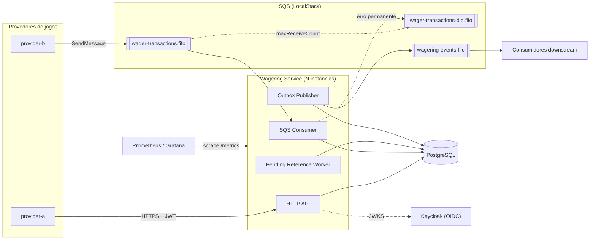

### Implantação local (Docker Compose)

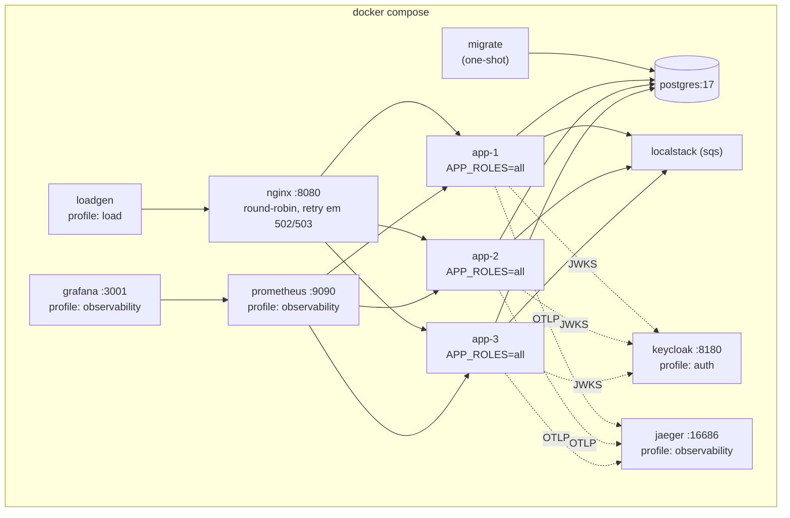

A mesma imagem (`Dockerfile`) roda todos os papéis; `APP_ROLES` (`api`, `consumer`, `outbox-publisher`, `pending-reference-worker`, `reconciliation-worker`) permite separá-los. `docker compose up -d --build --wait` sobe PostgreSQL, LocalStack, `migrate` (roda as migrations e sai), 3 réplicas de `app` com todos os papéis e o `lb` (nginx). O nginx re-resolve o DNS do Docker a cada 5 s e repassa um POST para outra réplica em `502/503` ou erro de conexão, o que é seguro porque toda submissão é idempotente pela `Idempotency-Key`. O IP de uma réplica morta não recusa a conexão, ele fica sem resposta; por isso o `proxy_connect_timeout` é de 500 ms, e `worker_connections` comporta rajadas de centenas de requisições simultâneas (DL-028). `stop_grace_period: 30s` é maior que `SHUTDOWN_GRACE_MS` (20 s), então o `SIGTERM` drena antes do `SIGKILL` do Docker.

Profiles opcionais:

| Profile | Serviços | Uso |
|---|---|---|
| `observability` | Prometheus (descobre cada réplica pelo DNS do Docker, scrape a cada 5 s), Grafana com datasource e dashboard provisionados (anônimo, só leitura), Jaeger | métricas e traces; os traces só saem com `OTEL_EXPORTER_OTLP_ENDPOINT=http://jaeger:4318` |
| `auth` | Keycloak com o realm `wagering` importado no boot (`docker/keycloak`) | junto com `AUTH_MODE=keycloak` (§11) |
| `load` | `loadgen`: o teste de carga dentro da rede do Compose | [docs/LOAD_TEST.md](docs/LOAD_TEST.md) |

---

## 3. Camadas e módulos

Arquitetura hexagonal (portas e adaptadores) com DDD tático.

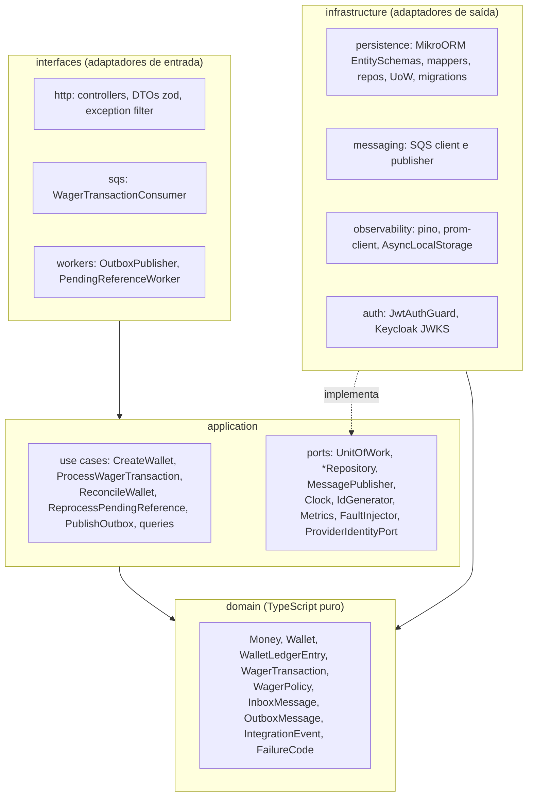

**Regra de dependência:** `domain` não importa nada; `application` importa só `domain`; `infrastructure` e `interfaces` importam ambos. Verificado por lint (restrição de imports) e revisão.

### Estrutura de diretórios

```
src/
  domain/
    shared/        DomainError, tipos utilitários
    money/         Money
    wallet/        Wallet, WalletLedgerEntry, LedgerDirection
    wagering/      WagerTransaction, enums, FailureCode, WagerPolicy
    messaging/     InboxMessage, OutboxMessage, IntegrationEvent + eventos
  application/
    ports/
    use-cases/
    services/      PayloadHasher, TransientRetry
  infrastructure/
    config/  persistence/  migrations/  messaging/  observability/  auth/
  interfaces/
    http/  sqs/  workers/
  app.module.ts
  main.ts
test/
  unit/  integration/  concurrency/  support/
load/              cenários de carga (bun run test:load)
docker/            init do postgres, localstack, realm keycloak, prometheus, grafana
```

---

## 4. Modelo de domínio

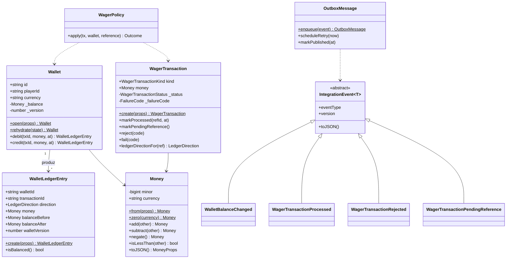

### 4.1 `Money`

- Representação interna: **`bigint` em unidades menores (centavos)**, escala fixa 2. Aritmética exata e sem dependência (ADR-002).
- `Money.from({ amount, currency })` é o parser de **contrato de entrada**: aceita somente `^(0|[1-9][0-9]*)\.[0-9]{2}$` (escala exata 2, sem sinal, sem espaços, sem expoente) e moeda `^[A-Z]{3}$`. Rejeita `NaN`, `Infinity`, `1e3`, `""`, `"10.005"`, `"-1.00"`, `"10"`, `"010.00"`. Valor máximo limitado ao `numeric(20,2)`.
- Não existe arredondamento implícito em lugar nenhum: entrada com mais casas é rejeitada, não arredondada.
- Valores negativos só surgem internamente (`negate`, `subtract`) e são serializados com `-`.
- Persistência: `amount numeric(20,2)` + `currency char(3)`; o driver devolve `numeric` como string, o mapper converte string → `Money` sem passar por `number`.

### 4.2 `Wallet`

- `debit`/`credit` recebem `ledgerEntryId`, `transactionId`, `money` e `at`, validam moeda e não-negatividade, atualizam `_balance`, incrementam `_version` e **retornam o `WalletLedgerEntry`** correspondente. Assim, saldo e lançamento nascem juntos e não há como mudar saldo sem lançamento.
- `version = 1` após `open` (inclusive com `OPENING`); `+1` a cada alteração de saldo; `LOSS`, `REJECTED` e `PENDING_REFERENCE` não incrementam.
- `walletVersion` do lançamento = `version` da wallet após a alteração. É a chave de ordenação e o cursor do ledger.

### 4.3 `WagerTransaction` — máquina de estados

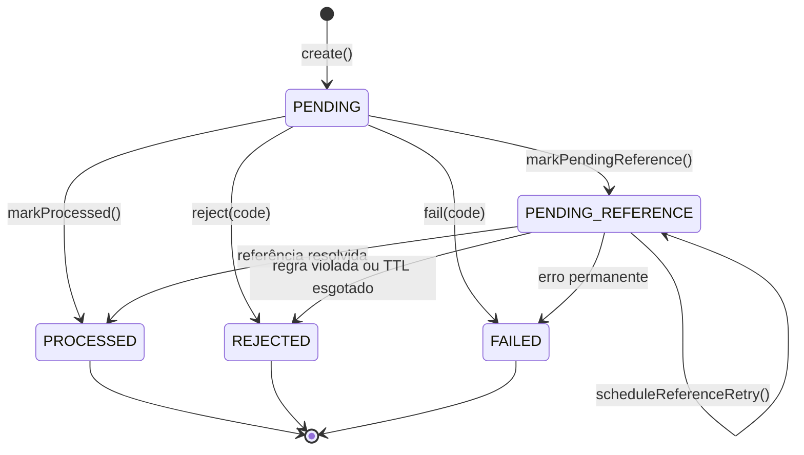

- Qualquer transição a partir de `PROCESSED`, `REJECTED` ou `FAILED` lança `InvalidTransactionStateError` (erro de programação) **e** é bloqueada por trigger no banco.
- `PENDING` existe em memória durante o processamento síncrono; não é persistido no fluxo atual (o schema o aceita para um futuro modo de aceite assíncrono).
- `FAILED` é usado quando o processamento atinge um erro permanente não-negocial: violação de invariante detectada pelo banco (`INVARIANT_VIOLATION`) ou retries de infraestrutura esgotados no worker de pendências (`PROCESSING_RETRIES_EXHAUSTED`). É terminal e auditável.

### 4.4 Regras por operação (`WagerPolicy`)

| Kind | Referência | Efeito | Rejeições possíveis |
|---|---|---|---|
| `OPENING` | — | `CREDIT` | só interno (API/fila → 400 `UNSUPPORTED_KIND`) |
| `BET` | — | `DEBIT` | `INSUFFICIENT_FUNDS` |
| `WIN` | opcional (`BET`) | `CREDIT` | `REFERENCE_MISMATCH` se informada e divergente |
| `LOSS` | opcional (`BET`) | nenhum | idem |
| `REFUND` | obrigatória, `BET` | `CREDIT` | `REFERENCE_KIND_NOT_REVERSIBLE`, `REFERENCE_ALREADY_REVERSED`, `REVERSAL_AMOUNT_MISMATCH`, `REFERENCE_NOT_PROCESSED` |
| `ROLLBACK` | obrigatória, `BET`/`WIN`/`REFUND` | inverso: `BET`→`CREDIT`; `WIN`/`REFUND`→`DEBIT` | as de `REFUND` + `REVERSAL_WOULD_OVERDRAW` |

Validação comum a todos: moeda da operação = moeda da wallet (`CURRENCY_MISMATCH`), `playerId` = dono da wallet (`WALLET_PLAYER_MISMATCH`). Para referência: mesmo provider, player, wallet, moeda e rodada (`REFERENCE_MISMATCH`).

### 4.5 Eventos de integração

| Evento | Quando | `aggregateId` |
|---|---|---|
| `WagerTransactionProcessed` v1 | qualquer transação `PROCESSED`, inclusive `LOSS` | `transactionId` |
| `WagerTransactionRejected` v1 | `REJECTED` (inclui TTL de referência) | `transactionId` |
| `WalletBalanceChanged` v1 | somente quando o saldo muda (inclui `OPENING`) | `walletId` |
| `WagerTransactionPendingReference` v1 | entrou em `PENDING_REFERENCE` | `transactionId` |
| `WalletOpened` v1 *(extra)* | wallet criada | `walletId` |

`data` carrega `MoneyProps` (string), nunca `Money`. `correlationId` vem da requisição/mensagem de origem; `causationId` é o `messageId` (SQS) ou o `Idempotency-Key` (HTTP).

---

## 5. Schema do banco e garantias

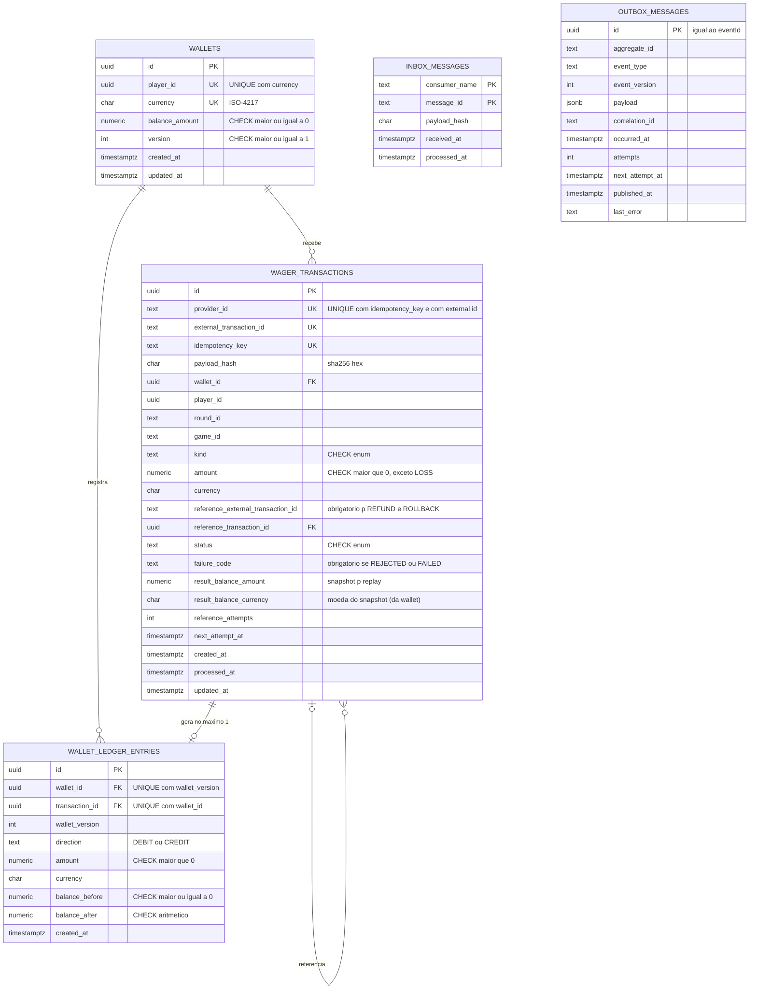

### 5.1 Garantias no schema (restrição 9)

| Garantia | Mecanismo |
|---|---|
| 1 wallet por `player + currency` | `UNIQUE (player_id, currency)` |
| Saldo nunca negativo | `CHECK (balance_amount >= 0)` em `wallets`; `CHECK (balance_after >= 0)` no ledger |
| Idempotência | `UNIQUE (provider_id, idempotency_key)` e `UNIQUE (provider_id, external_transaction_id)` |
| Referência obrigatória | `CHECK (kind NOT IN ('REFUND','ROLLBACK') OR reference_external_transaction_id IS NOT NULL)` |
| Uma reversão efetiva por referência | `UNIQUE (reference_transaction_id) WHERE status = 'PROCESSED' AND kind IN ('REFUND','ROLLBACK')` |
| Um `OPENING` por wallet | `UNIQUE (wallet_id) WHERE kind = 'OPENING'` |
| Rejeição auditável | `CHECK (status NOT IN ('REJECTED','FAILED') OR failure_code IS NOT NULL)` |
| Terminal é terminal | trigger `BEFORE UPDATE` em `wager_transactions` recusa mudança de `status` (e de colunas de negócio) se `OLD.status` é terminal |
| ≤ 1 lançamento por transação por wallet | `UNIQUE (transaction_id, wallet_id)` |
| Aritmética do lançamento | `CHECK ((direction='CREDIT' AND balance_after = balance_before + amount) OR (direction='DEBIT' AND balance_after = balance_before - amount))` |
| Ledger imutável | trigger `BEFORE UPDATE OR DELETE` → `RAISE EXCEPTION`; `REVOKE UPDATE, DELETE, TRUNCATE` do role `wallet_app` |
| Ledger encadeado | trigger `BEFORE INSERT`: `balance_before` = `balance_after` do lançamento anterior da wallet (ou 0) e `wallet_version` = anterior + 1 (sem buracos); `UNIQUE (wallet_id, wallet_version)` |
| **Saldo == ledger** | `CONSTRAINT TRIGGER … DEFERRABLE INITIALLY DEFERRED` em `wallets` **e** no ledger: no COMMIT, relê a wallet e exige `balance_amount`/`version` iguais ao `balance_after`/`wallet_version` do último lançamento (sem lançamentos: saldo 0 e versão 1) |
| Lançamento ⇔ transação aplicada | dois constraint triggers diferidos: todo lançamento aponta para uma transação `PROCESSED` de mesmo valor (nunca `LOSS`/`REJECTED`), e toda transação `PROCESSED` que move dinheiro tem seu lançamento |
| Lançamento na wallet e moeda certas | FKs compostas `(wallet_id, currency) → wallets (id, currency)` e `(transaction_id, wallet_id) → wager_transactions (id, wallet_id)` |
| Coerência status × colunas | `CHECK`s: `failure_code` ⇔ `REJECTED/FAILED`; `processed_at` ⇔ terminal; `next_attempt_at` ⇔ `PENDING_REFERENCE`; snapshot de saldo obrigatório fora de `PENDING/FAILED`; reversão `PROCESSED` com referência resolvida; `BET`/`OPENING` sem referência; `OPENING` só do provider `internal` |
| Histórico nunca apagado | triggers `BEFORE DELETE`/`TRUNCATE` em `wager_transactions` e `inbox_messages`; o role da app não tem `DELETE` em nenhuma tabela |
| Inbox única | `PRIMARY KEY (consumer_name, message_id)` |
| Outbox só avança | trigger: evento (tipo, versão, payload) imutável, `attempts` não decresce, mensagem publicada congelada; `CHECK` publicada ⇔ sem `next_attempt_at` |

Roles: `wallet_owner` é dono das tabelas e roda migrations; `wallet_app` (runtime) tem apenas `SELECT, INSERT` no ledger e `SELECT, INSERT, UPDATE` nas demais. Triggers protegem inclusive contra o owner.

Cada linha desta tabela tem um teste em `test/integration/persistence/schema-constraints.test.ts` que tenta violá-la direto via SQL e exige o SQLSTATE e o nome da constraint. Remover qualquer uma das garantias faz o teste correspondente falhar (verificado com mutações durante o Sprint 2).

### 5.2 Índices operacionais

- `wager_transactions (next_attempt_at) WHERE status = 'PENDING_REFERENCE'` — varredura do worker.
- `wager_transactions (provider_id, reference_external_transaction_id) WHERE status = 'PENDING_REFERENCE'` — "nudge" quando a referência chega.
- `wallet_ledger_entries (wallet_id, wallet_version DESC)` — cursor e encadeamento (coberto pelo UNIQUE).
- `outbox_messages (next_attempt_at) WHERE published_at IS NULL` — publisher.

Migrations: MikroORM Migrator com SQL explícito (`up`/`down`) — triggers e índices parciais escritos à mão, não gerados. Testadas com `up → down → up`.

---

## 6. Concorrência

**Estratégia: lock pessimista de linha por wallet + versão como segunda barreira + CHECK no banco como terceira** (ADR-003).

```sql
BEGIN;                                   -- READ COMMITTED
SET LOCAL lock_timeout = '2s';
SET LOCAL statement_timeout = '5s';
SELECT * FROM wallets WHERE id = $1 FOR UPDATE;           -- serializa só esta wallet
SELECT * FROM wager_transactions
 WHERE provider_id = $2 AND idempotency_key = $3;         -- já enxerga commits concorrentes
-- ... domínio decide ...
INSERT INTO wager_transactions ...;                       -- antes do lançamento (FK composta)
INSERT INTO wallet_ledger_entries ...;                    -- trigger confere o encadeamento
UPDATE wallets SET balance_amount = $4, version = $6, updated_at = $7
 WHERE id = $1 AND version = $5;                          -- 1 linha ou ConcurrencyConflictError
INSERT INTO outbox_messages ...;
COMMIT;                                                   -- triggers diferidos validam saldo == ledger
```

Por que **READ COMMITTED**: após obter o lock, cada nova instrução enxerga o último estado confirmado. Isso torna a checagem de idempotência e de "já revertida" correta sem `SERIALIZABLE` (que geraria falhas de serialização em massa numa hot wallet).

### Cenário obrigatório — 100.00 BRL, duas apostas de 80.00

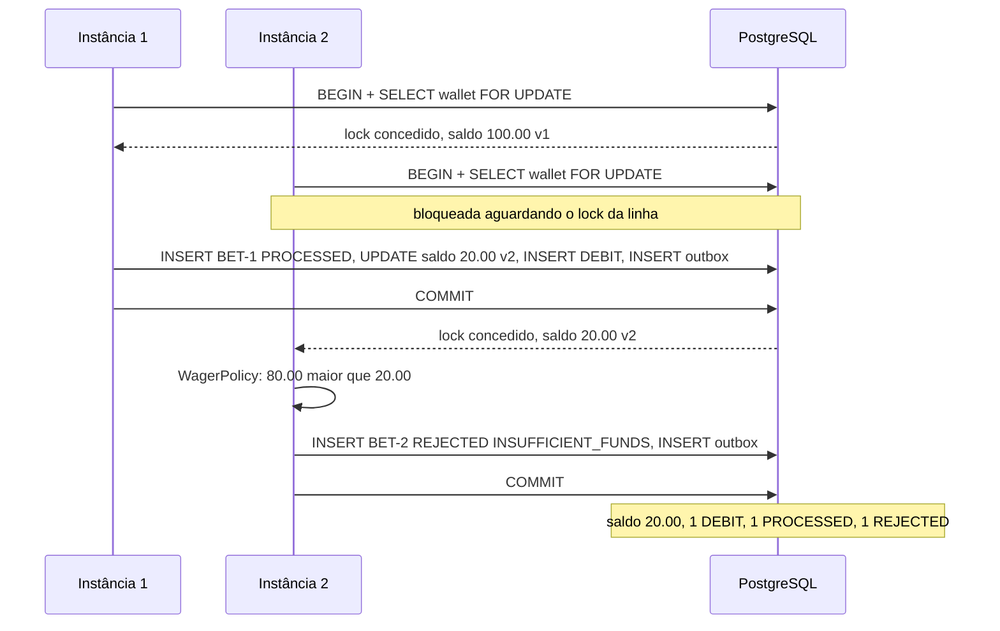

### Ordem global de locks (evita deadlock)

`inbox_messages` (insert) → `wallets` (FOR UPDATE) → `wager_transactions` (referência / pendentes) → inserts.
Cada transação toca **uma única wallet**, então não há ciclo entre wallets. O worker de pendências segue a mesma ordem: lê candidatos sem lock, depois `wallet FOR UPDATE` e só então `tx FOR UPDATE SKIP LOCKED`.

### Retry de erros transitórios

`40P01` (deadlock), `55P03` (lock timeout), `40001` (serialization), `OptimisticLockError` e perda de conexão → até 3 tentativas da transação inteira (classificação pelo SQLSTATE em `err.code`, ver §13.1), com espera determinística de 20 ms e 40 ms (`withTransientRetry`). Esgotado: HTTP 503 `Retry-After`; SQS não dá ack. `23505` em `uq_tx_idempotency` ou `uq_tx_external_id` (duas requisições com a mesma chave em wallets diferentes) é tratado como transitório: a perdedora reexecuta e cai no caminho de replay/conflito. Medido no teste de concorrência: 20 de 20 corridas passaram por esse caminho.

**Hot wallet:** o lock serializa as operações dela; throughput por wallet ≈ 1 / latência da transação. Wallets diferentes não competem. Medido no teste de carga.

---

## 7. Idempotência

Três camadas, todas persistentes:

| Camada | Chave | Protege contra |
|---|---|---|
| Inbox (só SQS) | `(consumer_name, message_id)` | redelivery da mesma mensagem |
| Idempotency key | `(provider_id, idempotency_key)` | mesma operação por canais/mensagens diferentes |
| External id | `(provider_id, external_transaction_id)` | key diferente para a mesma operação do provedor |

**`payloadHash`** = `sha256_hex(canonicalJson(subset))`, onde `subset` contém apenas campos de negócio: `providerId, externalTransactionId, playerId, walletId, roundId, gameId, kind, money{amount,currency}, referenceExternalTransactionId` (omitido se ausente). `canonicalJson` ordena chaves recursivamente, sem espaços, UTF-8. Header, `messageId`, `occurredAt` e metadados de transporte **não** entram. Como `amount` é validado com escala exata, a string já é canônica.

Resultado de uma submissão repetida:

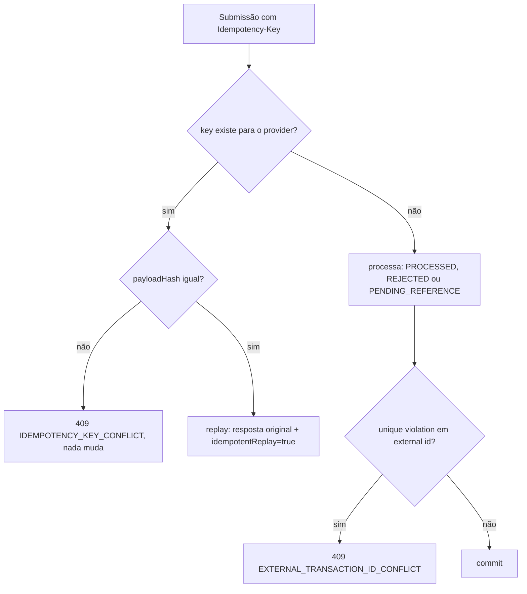

O replay usa o snapshot persistido (`status`, `failure_code`, `result_balance_amount`/`result_balance_currency`), por isso devolve o saldo observado no momento do processamento original.

---

## 8. Fluxos principais

### 8.1 Submissão via HTTP

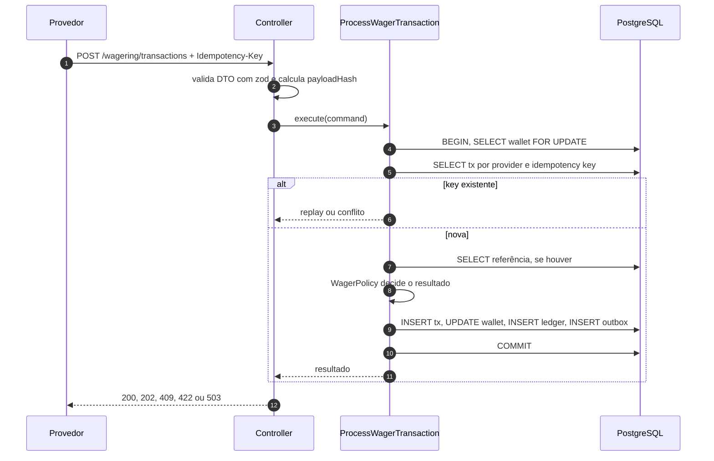

### 8.2 Consumo SQS com inbox

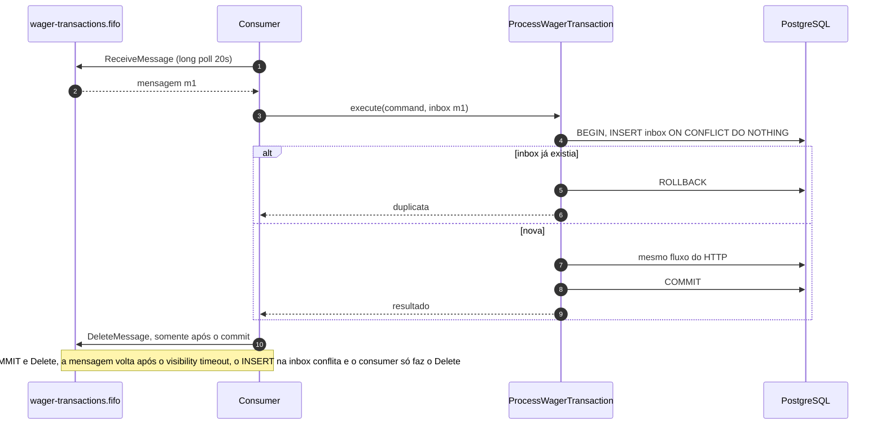

Classificação de erros do consumer:

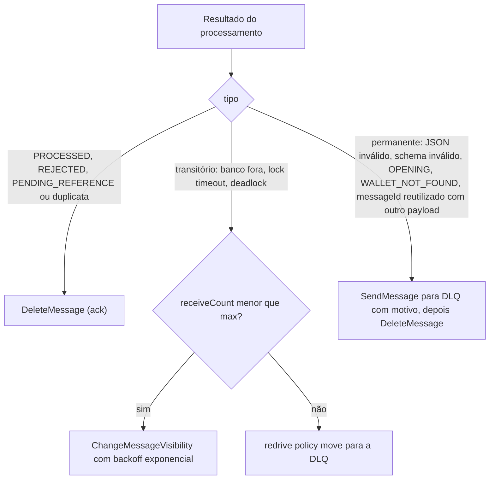

Princípio: **o que pode ser representado no domínio vira `REJECTED` auditável e recebe ack; o que não pode vai para a DLQ, que funciona como trilha de auditoria.** Erros desconhecidos são tratados como transitórios: o `maxReceiveCount` da redrive policy é o teto.

Detalhes de implementação (`WagerTransactionConsumer`):
- A chave da inbox é o `messageId` **do corpo** (atribuído pelo produtor e estável entre reenvios), não o `MessageId` do SQS, que muda a cada envio (I-17). O `payloadHash` da inbox é o SHA-256 do JSON canônico de `{type, data}`.
- A inbox é gravada antes do lock da wallet (ordem de locks) e uma duplicata não tem caminho especial: segue para a busca por idempotency key e vira replay, com ack.
- Lote recebido: grupos FIFO (wallets) em paralelo, mensagens de um grupo em sequência; depois de uma mensagem que vai ser repetida, o resto do grupo é liberado (`visibility 0`) para não furar a ordem.
- Backoff de transitórios: `SQS_RETRY_BASE_SECONDS · 2^(receiveCount−1)`, teto `SQS_RETRY_MAX_SECONDS`, via `ChangeMessageVisibility`.
- Mensagens para a DLQ levam `failureCode`, `failureReason` e `sourceQueue` como atributos, e o corpo original intacto.

`SIGTERM`: o loop para de chamar `ReceiveMessage` (abort do long poll), mensagens do lote ainda não iniciadas recebem `ChangeMessageVisibility 0`, as em andamento terminam dentro de `SHUTDOWN_GRACE_MS` (menor que o `stop_grace_period` do Compose). Os workers param em `beforeApplicationShutdown`, antes de o pool do banco e o client SQS fecharem. Readiness respondendo 503 durante o shutdown chega com o `/health/ready` (Sprint 5).

### 8.3 Outbox publisher (vários publishers)

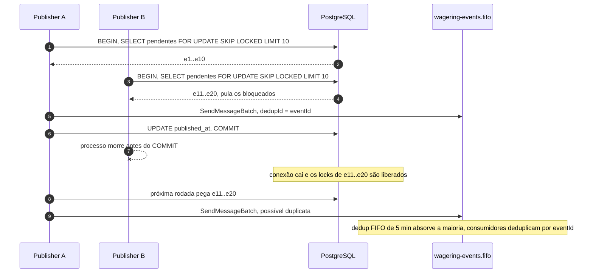

- Falha de publish → `scheduleRetry`: `attempts + 1`, `next_attempt_at = now + min(1s * 2^attempts, 5min)`, sem jitter (backoff determinístico no domínio; publishers concorrentes já se evitam com `SKIP LOCKED`). Nunca descarta: um evento confirmado não se perde (métrica e alerta para `attempts` alto).
- Cenário da especificação (commit → crash → outra instância publica → duplicata segura) é coberto porque a outbox é gravada na transação financeira e a publicação é at-least-once com `eventId` estável.
- Ordem: publishers concorrentes podem inverter eventos da mesma wallet. Consumidores ordenam por `walletVersion` (presente em `WalletBalanceChanged`). Ver limitações.
- Claim em ordem `occurred_at, id`, lote de `OUTBOX_BATCH_SIZE`, `SendMessageBatch` em blocos de 10 com `MessageGroupId = aggregateId` e atributos `eventType`, `eventVersion`, `correlationId`. Falhas parciais do lote viram retry só das mensagens recusadas.
- **Pistas paralelas** (ADR-016): o lote é dividido em 4 pistas por hash do `aggregateId` e as pistas enviam em paralelo. Todos os eventos de uma wallet vão pela mesma pista e na ordem do claim, então o paralelismo não inverte eventos de uma mesma wallet. Uma falha de envio marca para retry só o restante da sua pista. Publicação e retries de todo o lote são gravados num único `UPDATE` (`jsonb_to_recordset`). Essa mudança saiu do teste de carga: antes, o lag chegava a 31 s com ~1000 eventos/s (DL-023).

### 8.4 Referência fora de ordem (`PENDING_REFERENCE`)

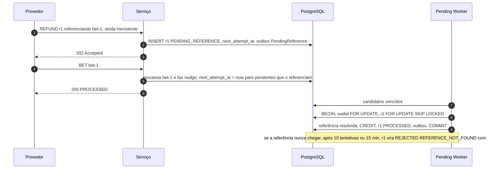

Backoff: `1s, 2s, 4s … teto 5 min`, no máximo **10 tentativas ou TTL de 15 min** (o que vier primeiro), configuráveis.

O worker (`ReprocessPendingReferencesUseCase`) lê os candidatos vencidos sem lock e trata cada um numa transação própria, na ordem de locks de sempre: `wallet FOR UPDATE` → `transação FOR UPDATE` → re-checagem (ainda pendente e vencida?). Vários workers podem rodar ao mesmo tempo; quem chega depois só encontra a transação resolvida e pula. O nudge acorda apenas pendências **da mesma wallet** (as de outra wallet seriam rejeitadas por `REFERENCE_MISMATCH` de qualquer jeito) e roda também quando o próprio worker resolve uma transação, o que destrava cadeias como `ROLLBACK` de um `REFUND` pendente. Eventos emitidos pelo worker usam `correlationId = idempotencyKey` da transação e `causationId = pending-reference:<id>`. Justificativa: provedores normalmente reenviam a operação original em segundos/minutos; manter pendências por mais tempo distorce a reconciliação e o saldo exibido ao jogador. O nudge torna a latência independente do backoff no caso comum.

### 8.5 Criação de wallet e reconciliação

- `POST /wallets`: numa transação, `INSERT wallet (v1)`; se `initialBalance > 0`, `INSERT wager_transactions (OPENING, PROCESSED)` + `INSERT ledger (CREDIT, v1)` + outbox `WalletOpened` e `WalletBalanceChanged`. Resposta 201. Duplicata → `23505` em `uq_wallets_player_currency` → 409 `WALLET_ALREADY_EXISTS`.
- `GET /wallets/:id/ledger`: mais recentes primeiro, keyset por `wallet_version`. O cursor é opaco (`base64url` de `{walletId, version}`): estável porque o ledger é imutável e a versão é monotônica, e recusado (400) se usado em outra wallet. `limit` entre 1 e 200, padrão 50.
- `POST /wallets/:id/reconciliation`: transação `REPEATABLE READ READ ONLY` (snapshot consistente, sem bloquear escritores): `calculated = Σ CREDIT − Σ DEBIT`; compara com `balance_amount` e com o `balance_after` do último lançamento. Divergência → log `error` com `walletId`, métrica `wallet_reconciliation_divergences_total{trigger}`, `consistent: false`. Nada é corrigido.
- **Reconciliação periódica por amostragem** (D-07, papel `reconciliation-worker`): a cada `RECONCILIATION_INTERVAL_MS` (60 s), `RECONCILIATION_SAMPLE_SIZE` wallets (25) passam pela mesma comparação, com `trigger=sampled`. A amostra põe primeiro as wallets alteradas na última janela, onde um desvio por fora da aplicação é mais provável, e completa com wallets aleatórias, para que as paradas também sejam verificadas com o tempo (`ORDER BY (updated_at >= ?) DESC, random()`). É só leitura e sem lock: com N instâncias o trabalho só se sobrepõe. O custo é uma varredura de `wallets` por execução, aceitável a cada minuto; com milhões de wallets o caminho seria `TABLESAMPLE` ou cursor de varredura.
- Criar wallet, ler o ledger e reconciliar exigem o papel de backoffice quando a autenticação está ligada (§11).

---

## 9. Contratos: HTTP e failure codes

### 9.1 Mapeamento de status (consistente em todos os endpoints)

| Situação | HTTP | Corpo | Provedor deve |
|---|---|---|---|
| Processada (nova ou replay) | **200** | `{transactionId, status: PROCESSED, balance, idempotentReplay}` | seguir |
| Aceita, aguardando referência | **202** | `status: PENDING_REFERENCE` | consultar depois / aguardar evento |
| Payload inválido / header ausente | **400** | problem+json `VALIDATION_ERROR` + detalhes | corrigir payload |
| Não autenticado / provider divergente do token / sem o papel exigido | **401 / 403** | `UNAUTHENTICATED` / `PROVIDER_MISMATCH` (provider autenticado ≠ `providerId` do payload ou da URL) / `FORBIDDEN` (rota de backoffice) | corrigir credencial |
| Recurso da URL inexistente (consultas) | **404** | `NOT_FOUND` | — |
| Conflito de idempotência / external id / wallet duplicada | **409** | `IDEMPOTENCY_KEY_CONFLICT`, `EXTERNAL_TRANSACTION_ID_CONFLICT`, `WALLET_ALREADY_EXISTS` | **não** reenviar igual |
| Rejeição de regra de negócio | **422** | `{transactionId, status: REJECTED, failureCode, balance, idempotentReplay}` | desistir ou corrigir |
| Wallet inexistente (rejeição sem agregado, I-04) | **422** | problem+json `WALLET_NOT_FOUND` | corrigir payload |
| Falha transitória (inclui `IDENTITY_PROVIDER_UNAVAILABLE`: chaves do IdP inacessíveis e fora do cache) | **503** + `Retry-After` | `retryable: true` | reenviar a mesma requisição |
| Transação `FAILED` (replay) | **500** | `{transactionId, status: FAILED, failureCode, idempotentReplay}` | escalar |
| Erro inesperado / invariante violada | **500** | problem+json, `retryable: false` | escalar |

Erros seguem `application/problem+json` (RFC 9457) com `code` e `retryable`. Replay devolve o **mesmo** status e corpo do original, com `idempotentReplay: true`.

### 9.2 Taxonomia de `failureCode`

| Código | Categoria | Persistido? | Ação sugerida |
|---|---|---|---|
| `INSUFFICIENT_FUNDS` | negócio | `REJECTED` | desistir |
| `REVERSAL_WOULD_OVERDRAW` | negócio | `REJECTED` | escalar (operacionalmente diferente de aposta sem saldo) |
| `CURRENCY_MISMATCH` | negócio | `REJECTED` | corrigir payload |
| `WALLET_PLAYER_MISMATCH` | negócio | `REJECTED` | corrigir payload |
| `REFERENCE_NOT_FOUND` | negócio | `REJECTED` (após TTL) | reenviar a referência e depois a reversão com nova key |
| `REFERENCE_MISMATCH` | negócio | `REJECTED` | corrigir payload |
| `REFERENCE_KIND_NOT_REVERSIBLE` | negócio | `REJECTED` | corrigir payload |
| `REFERENCE_NOT_PROCESSED` | negócio | `REJECTED` | desistir |
| `REFERENCE_ALREADY_REVERSED` | negócio | `REJECTED` | desistir (já aplicado) |
| `REVERSAL_AMOUNT_MISMATCH` | negócio | `REJECTED` | corrigir payload |
| `WALLET_NOT_FOUND` | negócio | não (sem agregado) | corrigir payload |
| `VALIDATION_ERROR`, `INVALID_MONEY`, `UNSUPPORTED_KIND`, `MISSING_REFERENCE` | validação | não | corrigir payload |
| `IDEMPOTENCY_KEY_CONFLICT`, `EXTERNAL_TRANSACTION_ID_CONFLICT` | conflito | não | não reenviar |
| `DATABASE_UNAVAILABLE`, `LOCK_TIMEOUT`, `CONCURRENCY_CONFLICT`, `BROKER_UNAVAILABLE` | transitório | não | reenviar igual |
| `INVARIANT_VIOLATION`, `PROCESSING_RETRIES_EXHAUSTED` | permanente | `FAILED` | escalar |

---

## 10. Observabilidade

**Logs** (pino, JSON): contexto via `AsyncLocalStorage` com `correlationId`, `messageId`, `transactionId`, `walletId`, `providerId`, `kind`, `status`, `failureCode`. `redact` para `money`, `balance*`, `amount` e headers de autenticação. Payload completo nunca é logado.

Implementação: um middleware Express (`correlationMiddleware`, registrado antes do pino-http) abre o contexto de cada requisição com o `x-correlation-id` recebido ou um UUIDv7 novo; o consumer abre um por mensagem e os workers um por ciclo. Os adaptadores enriquecem o contexto (`logContext.assign`) conforme aprendem `walletId`, `providerId` e `transactionId`, e um `mixin` do pino carimba os campos em toda linha, inclusive nos logs dos casos de uso. O teste multi-instância verifica os campos nas linhas reais e que nenhuma linha contém um valor monetário.

**Métricas** (prom-client, `GET /metrics`):

| Métrica | Tipo | Labels |
|---|---|---|
| `wagering_transactions_total` | counter | `kind`, `status`, `source` (http/sqs/worker) |
| `wagering_processing_duration_seconds` | histogram | `kind`, `source`, `outcome` |
| `wagering_idempotent_replays_total` / `wagering_idempotency_conflicts_total` | counter | `source` |
| `inbox_duplicates_total` | counter | `consumer` |
| `processing_retries_total` | counter | `reason` |
| `db_lock_conflicts_total` | counter | `type` (lock_timeout, deadlock, serialization, version) |
| `sqs_dlq_messages_total` | counter | `reason` |
| `sqs_dlq_depth` | gauge | `queue` |
| `outbox_pending_messages` / `outbox_lag_seconds` | gauge | — |
| `outbox_publish_total` | counter | `result` |
| `pending_reference_transactions` | gauge | — |
| `wallet_reconciliations_total` / `wallet_reconciliation_divergences_total` | counter | `trigger` (request/sampled) |

**Health:** `/health/live` (processo responde) e `/health/ready` (`SELECT 1` + `GetQueueAttributes` em cada fila configurada, timeout de 2 s cada; 503 com `status: not-ready` e o detalhe de cada dependência, ou `status: shutting-down`). O estado de shutdown é marcado em `onModuleDestroy`, que o Nest executa antes de qualquer `beforeApplicationShutdown`; marcar no mesmo hook dos workers deixaria a instância "pronta" durante toda a drenagem (DL-021). Ambos sem autenticação, assim como `/metrics`.

Origem das métricas: `ProcessWagerTransactionUseCase` (resultado, duração, replay, conflito, duplicata de inbox), `withTransientRetry` (retries e conflitos de lock, com o motivo vindo do SQLSTATE), consumer (DLQ), outbox relay (publicadas/falhas), worker (resultados com `source=worker`) e gauges calculados no scrape (backlog e idade da outbox, pendências, profundidade da DLQ).

**Dashboard** (profile `observability`): o Grafana em `:3001` abre direto no dashboard "Wagering — visão operacional" (`docker/grafana/dashboards/wagering.json`). Ele mostra réplicas no ar, transações/s por tipo, status e origem, latência p50/p95/p99, replays, conflitos de idempotência e duplicatas da inbox, conflitos de lock e retries, backlog e lag da outbox, pendências, DLQ, divergências de reconciliação e memória por réplica.

**Traces** (OpenTelemetry, opt-in com `OTEL_EXPORTER_OTLP_ENDPOINT`; Jaeger em `:16686`): `src/infrastructure/observability/tracing.ts` é o primeiro import do `main.ts` e instrumenta `http` e `pg` (ADR-018). Uma requisição vira `POST` → `ProcessWagerTransaction` → `pg.query` (BEGIN … COMMIT). Uma mensagem vira `wager-transactions.fifo process` → `ProcessWagerTransaction` → `pg.query`. O relay gera `wagering-events.fifo publish`, com os `correlationId` do lote como atributo. Health, `/metrics` e polls ociosos dos workers não geram spans. No Compose, 10% dos traces são amostrados (`parentbased_traceidratio`): exportar todos sob saturação descartava spans e custava 12% do throughput (DL-029). As linhas de log de uma operação rastreada levam `traceId` e `spanId`. Atributos seguem a regra dos logs: nada de valores ou saldos.

---

## 11. Autenticação

Requisito opcional, implementado com escopo limitado no Sprint 6 sobre o ponto de extensão que existia desde o Sprint 2.

- **IdP:** Keycloak 26 no profile `auth`, com o realm `wagering` importado no boot (`docker/keycloak/wagering-realm.json`). Os segredos ali são de desenvolvimento.
- **Provedores:** um client confidencial por provedor (`provider-a`, `provider-b`), fluxo `client_credentials`. Um mapper fixa a claim `provider_id` e outro põe `wagering-api` na audiência.
- **Backoffice:** o client `backoffice` tem a service account com a realm role `wallet-admin`.
- **Aplicação** (`AUTH_MODE=keycloak`): `JwtProviderIdentity` (`src/infrastructure/auth`) valida o token localmente com `jose`, sem chamar o IdP por requisição (ADR-017):
  - verificação: assinatura RS256 pelo JWKS (em cache, renovado quando aparece um `kid` novo), `iss`, `aud`, `exp` e `sub`; `alg: none` e outros algoritmos são recusados;
  - mapeamento: a role `wallet-admin` vira `backoffice`; a claim `provider_id` vira `provider`; um token válido sem nenhuma das duas é `401`;
  - JWKS inacessível e fora do cache gera `503 IDENTITY_PROVIDER_UNAVAILABLE` (retryable), e não `401`, porque a falha é do IdP e não da credencial.
- **Emissor único:** com `KC_HOSTNAME=http://localhost:8180`, o `iss` é o mesmo para quem chega ao Keycloak por `localhost:8180` (host) ou `keycloak:8080` (rede do Compose). A app compara com `OIDC_ISSUER` e busca as chaves em `OIDC_JWKS_URL`, pela rede interna (DL-026).
- **Fila:** canal interno confiável (principal `trusted`), mas o `providerId` da mensagem passa pelas mesmas validações de domínio.
- `AUTH_MODE=disabled` (padrão) usa `TrustedProviderIdentity`: todo chamador é `trusted`. Health e `/metrics` ficam sempre abertos (`@Public()`).

**Autorização** (nos casos de uso, que recebem o `Principal`; `src/application/services/authorization.ts`):

| Operação | `provider` | `backoffice` | `trusted` |
|---|---|---|---|
| `POST /wagering/transactions` | só com `providerId` = o do token (`403 PROVIDER_MISMATCH`) | não (`403 PROVIDER_MISMATCH`) | sim |
| `GET /wagering/transactions/:id`, `GET /providers/:providerId/...` | só as próprias (I-15) | sim | sim |
| `GET /wallets/:id` (saldo) | sim | sim | sim |
| `POST /wallets`, `GET /wallets/:id/ledger`, `POST /wallets/:id/reconciliation` | `403 FORBIDDEN` | sim | sim |

O ledger fica restrito ao backoffice porque reúne os movimentos de todos os provedores na wallet.

```bash
# token de um provedor (client credentials)
curl -s http://localhost:8180/realms/wagering/protocol/openid-connect/token \
  -d grant_type=client_credentials -d client_id=provider-a -d client_secret=provider-a-secret
```

Testes: `jwt-provider-identity.test.ts` (unidade; chaves geradas no teste, JWKS local, IdP inacessível), `auth.test.ts` (integração HTTP com `AUTH_MODE=keycloak` e JWKS local) e o job `cluster` do CI, que sobe o Keycloak real e percorre o fluxo com tokens emitidos por ele.

---

## 12. Estratégia de testes

| Suíte | Infra | Como garante determinismo |
|---|---|---|
| `test:unit` | nenhuma | domínio puro, `Clock` e `IdGenerator` falsos |
| `test:integration` | PostgreSQL e LocalStack reais (Compose) | banco novo por arquivo via `CREATE DATABASE … TEMPLATE`; fila com sufixo único por teste |
| `test:concurrency` | idem + processos reais | `Promise.all` com pools independentes, `Bun.spawn` de ≥ 3 instâncias, `FaultInjector` para crash em pontos exatos, `waitFor` com timeout em vez de `sleep` |
| `test:load` | Compose com 3 réplicas atrás do nginx | closed loop com aquecimento; ao final, checagens de correção no banco (saldo = ledger, saldo = respostas confirmadas, uma linha por mensagem). Versão curta no CI. Ver [docs/LOAD_TEST.md](docs/LOAD_TEST.md) |

**Sem configuração:** `docker compose up -d --wait` e `bun test` bastam num clone limpo, sem `.env`. O template migrado é criado no primeiro uso (`ensureTemplate`, com `pg_advisory_lock`), e o harness usa os padrões do Compose e do LocalStack. O CI roda esse caminho além dos scripts. O contrato HTTP tem teste próprio (`openapi.test.ts`): toda rota servida está no OpenAPI e as respostas reais validam contra os schemas declarados.

Todo teste de integração ou concorrência que cria wallets ou move dinheiro termina com `assertLedgerConsistency(databaseUrl, walletIds?)` (`test/support/ledger-consistency.ts`), que verifica, com aritmética em `numeric` no próprio PostgreSQL: `wallet.balance == Σ CREDIT − Σ DEBIT`, último lançamento igual a saldo e versão, e sequência de versões sem buracos. Testes que não tocam em wallets (health, migrations, spike do ORM) não o chamam. A verificação de outbox sem perda (eventos esperados presentes) entra com o publisher, no Sprint 4.

**Crash injection:** `FaultInjector` é uma porta; em produção é no-op. Em teste, `FAULT_POINTS=after-commit-before-ack` faz o processo se matar com `SIGKILL` naquele ponto. Testes de sinal rodam em Linux (CI).

---

## 13. Registro de decisões (ADRs)

| ADR | Decisão | Alternativas | Motivo |
|---|---|---|---|
| 001 | **MikroORM 7** com `EntitySchema` + mappers para o domínio (validado no Sprint 0, ver §13.1) | TypeORM; decorators nas classes de domínio | preferencial na especificação; `em.transactional()` e `LockMode` explícitos; `EntitySchema` mantém o domínio sem decorators e permite construtores privados |
| 002 | `Money` em **`bigint` de centavos** | `decimal.js`, `big.js` | escala fixa 2 → inteiro é exato, nativo, sem dependência; só há soma/subtração |
| 003 | **Lock pessimista por wallet** (`FOR UPDATE`) + `version` + `CHECK` | só optimistic com retry; update atômico condicionado | hot wallets geram tempestade de retries no optimistic; o update condicionado sozinho não cobre a checagem de idempotência e de reversão única na mesma seção crítica |
| 004 | **READ COMMITTED** | REPEATABLE READ / SERIALIZABLE | o lock já serializa por wallet; níveis maiores só adicionam falhas de serialização |
| 005 | Outbox com **`FOR UPDATE SKIP LOCKED`** dentro de transação curta | lease com `locked_until` | crash libera o lock automaticamente; simples de raciocinar. Custo: conexão presa durante o `SendMessageBatch` (lote pequeno + timeout) |
| 006 | Idempotência **no banco** com escopo por provider | tabela separada de idempotency keys | a própria `wager_transactions` guarda key, hash e snapshot da resposta: uma linha, uma verdade |
| 007 | Garantia **saldo == ledger** por constraint trigger diferido | só reconciliação | converte a invariante central em erro de COMMIT, não em descoberta posterior |
| 008 | Mesma imagem, papéis por `APP_ROLES` | serviços separados | simplicidade local; escala por papel em produção |
| 009 | Validação com **zod** | class-validator | parsing estrito e tipado, também usado para config e mensagens SQS |
| 010 | Infra de teste via **Compose** + banco por arquivo de teste clonado de um template migrado | testcontainers; truncar tabelas entre testes | menos atrito com Bun; mesma infra no CI; clonar template é rápido e não exige `DELETE` (que o role da app nem tem) |
| 011 | CLI de migration próprio (`scripts/migrate.ts`) sobre `orm.migrator`, com `migrationsList` explícito | CLI do MikroORM | roda direto no Bun sem ts-node/descoberta de arquivos; migrations são SQL escrito à mão, sem geração por diff |
| 012 | Dois roles: `wallet_owner` (migrations) e `wallet_app` (runtime) | um único usuário | o runtime não consegue `DELETE`, `TRUNCATE` nem DDL; reforça ledger append-only (R-05) além dos triggers |
| 013 | MikroORM para transação, conexão, metadata (`EntitySchema`), consultas e locks; **escritas financeiras explícitas** (`em.insert`, `em.nativeUpdate … WHERE version = ?`) em ordem fixa; leituras com `disableIdentityMap` | Unit of Work com dirty-checking e `flush()` | a ordem dos statements importa (triggers, FKs compostas, ordem de locks) e o update de saldo precisa do guard de versão com contagem de linhas afetadas; o identity map serviria uma linha relida depois de uma escrita explícita como cópia velha |
| 014 | Patch versionado (`patches/kysely@0.29.6.patch`, `bun patch`) na dependência transitiva Kysely: liberar a conexão quando o `BEGIN` falha | trocar de ORM; reconectar o pool periodicamente | sem o patch, cada transação cujo `BEGIN` encontra um socket morto vaza um slot do pool para sempre — após N quedas de rede a instância trava (DL-020). O patch tem um teste de regressão que falha sem ele |
| 015 | Com `AWS_ENDPOINT_URL`, `useQueueUrlAsEndpoint: false` no client SQS | deixar o SDK seguir o host do `QueueUrl` | o LocalStack devolve URLs em `localhost.localstack.cloud:4566`; o SDK passaria a ignorar o endpoint configurado (DL-022) |
| 016 | Relay da outbox com **pistas paralelas por agregado** e **um `UPDATE` por lote** | lote maior; mais publishers; envio paralelo sem pistas | o teste de carga mostrou o relay sequencial (5 envios + 50 updates por lote) parado em ~800 eventos/s, com lag de 31 s. Pistas por hash do `aggregateId` dão paralelismo sem inverter os eventos de uma wallet; com a mudança, o lag ficou abaixo de 3 s (DL-023) |
| 017 | Autenticação: **validação local do JWT** (`jose`, JWKS em cache) e autorização nos casos de uso | introspecção do token no Keycloak a cada requisição; guard por rota | sem ida ao IdP por requisição, e o Keycloak fora do ar só importa enquanto as chaves não estão em cache; as regras (provider × payload, backoffice) ficam testáveis sem HTTP |
| 018 | **OpenTelemetry opt-in**, com auto-instrumentação de `http` e `pg` e spans manuais no SQS | sem tracing; SDK completo (`sdk-node`) | o spike mostrou que a instrumentação por `require` funciona sob Bun como sob Node. O AWS SDK v3 é ESM e não é instrumentado, por isso os spans do SQS são manuais. O `pg` é carregado uma vez por `require` para ficar instrumentado mesmo importado pela entrada ESM (DL-025) |
| 019 | Reconciliação periódica **por amostragem**, recentes primeiro, sem coordenação entre instâncias | varredura completa; lock consultivo para eleger uma instância | é só leitura: a sobreposição entre instâncias não afeta correção, e a amostra cobre primeiro onde um desvio é mais provável |

### 13.1 Resultados do spike do Sprint 0

Versões resolvidas: Bun 1.4.4, NestJS 12, MikroORM 7.2, TypeScript 7 (`tsc` nativo), zod 4, Biome 2.6, PostgreSQL 17, LocalStack 4.

| Verificação | Resultado | Evidência |
|---|---|---|
| NestJS 12 roda sob Bun com decorators e `emitDecoratorMetadata` | ok | `test/integration/http/health.test.ts` |
| `EntitySchema` com classe de persistência sem decorators | ok | `mikro-orm-spike.test.ts` |
| `em.transactional()` + `LockMode.PESSIMISTIC_WRITE` serializa 20 escritores concorrentes sem lost update | ok | idem |
| `SET LOCAL lock_timeout` dentro da transação | ok, mas o erro chega como `DriverException` genérica com `code: '55P03'`: o conversor do MikroORM 7 para PostgreSQL **não** mapeia lock timeout para `LockWaitTimeoutException` | idem |
| `numeric(20,2)` volta como string exata (`'999999999999999999.99'`) | ok | idem |
| Migrations `up → down → up` via `orm.migrator` sob Bun | ok | `migrations.test.ts` e CI |
| TypeScript 7 removeu `baseUrl` | aliases de caminho abandonados; imports relativos | `tsconfig.json` |

**Consequência para o Sprint 3:** a classificação de erros transitórios (§6) é feita pelo **SQLSTATE** (`err.code`), não pela classe da exceção.

---

## 14. Interpretações das regras

| # | Interpretação | Justificativa |
|---|---|---|
| I-01 | Uma referência admite **no máximo uma reversão efetiva**, independentemente do tipo (`REFUND` ou `ROLLBACK`) | a regra 4 fala "pelo mesmo tipo", mas `REFUND` + `ROLLBACK` sobre a mesma `BET` creditaria duas vezes — viola a invariante de não duplicar créditos. `ROLLBACK` de um `REFUND` continua permitido (é outra referência) |
| I-02 | `WIN`/`LOSS` com referência informada passam pela mesma validação; referência ausente → `PENDING_REFERENCE` | consistência com `REFUND`/`ROLLBACK` |
| I-03 | `BET` que chega depois de sua reversão pendente é processada normalmente (sem "tombstone") | segue o fluxo da especificação; o efeito líquido é zero |
| I-04 | `WALLET_NOT_FOUND` não é persistido (sem agregado a que pertencer): HTTP 422; SQS → DLQ | a DLQ é a trilha de auditoria do que não cabe no domínio |
| I-05 | `amount` exige escala exata de 2 casas (`"25.00"`, não `"25"`) | o contrato diz "sempre com escala fixa de 2 casas" |
| I-06 | `LOSS` aceita `0.00`; demais kinds exigem valor > 0 | `LOSS` não move saldo |
| I-07 | Replay de `PENDING_REFERENCE` devolve o estado atual da transação | o "resultado original" se aplica a transações terminais |
| I-08 | `ROLLBACK` de `LOSS` e de `ROLLBACK` → `REFERENCE_KIND_NOT_REVERSIBLE` | `LOSS` não tem efeito; reverter reversão abre ciclo |
| I-09 | Referência `REJECTED`/`FAILED` → `REFERENCE_NOT_PROCESSED`; referência em `PENDING_REFERENCE` → continua pendente | só se reverte o que foi aplicado |
| I-10 | Mesmo `messageId` com payload diferente → DLQ + métrica | indica bug do produtor, não replay |
| I-11 | Idempotency key tem escopo por `providerId` | evita colisão entre provedores |
| I-12 | `BET` não aceita `referenceExternalTransactionId` (400 `VALIDATION_ERROR`) | aposta abre a rodada; não há o que referenciar |
| I-13 | `WIN`/`LOSS` com referência que não é uma `BET` → `REFERENCE_MISMATCH` | o resultado de rodada só liquida uma aposta; `REFERENCE_KIND_NOT_REVERSIBLE` fica reservado às reversões |
| I-14 | `providerId = "internal"` é reservado → 400 `VALIDATION_ERROR` | identifica o `OPENING`; sem a regra, o CHECK do banco viraria um 500 |
| I-15 | Consulta por id interno de transação de outro provider → 404; pela rota `/providers/:providerId/...` com provider alheio → 403 | não revelar a existência de transações alheias por id; a rota por provider já declara de quem é |
| I-16 | `REFUND`/`ROLLBACK` que chega antes da referência e cuja referência depois chega: fica `PENDING_REFERENCE` até o worker (Sprint 4) | a resolução imediata ("nudge") é parte do worker |
| I-17 | A chave da inbox é o `messageId` do corpo da mensagem, não o `MessageId` do SQS | o do corpo é do produtor e estável entre reenvios; o do SQS muda a cada envio e não deduplicaria uma mensagem reenviada |
| I-18 | Conflito de idempotência (mesma chave, payload diferente) e `WALLET_NOT_FOUND` vindos da fila vão para a DLQ, não recebem ack silencioso | não há agregado onde registrar a rejeição; a DLQ é a trilha de auditoria (princípio do §8.2) |
| I-19 | Valores acima do que `numeric(20,2)` comporta (999 999 999 999 999 999,99) são `400 INVALID_MONEY`, inclusive quando o excesso está no **saldo resultante** de um crédito, e nada é persistido | o limite é verificado em `Money` antes de qualquer escrita, então nunca vira erro do banco (500). Um código de rejeição de negócio próprio exigiria migration nova para um caso fora de qualquer uso real |
| I-20 | Mesmo `externalTransactionId` com outra `Idempotency-Key` → `409 EXTERNAL_TRANSACTION_ID_CONFLICT` | a chave é a fonte da verdade da idempotência, mas o id externo também é único por provedor no schema; aceitar as duas chaves aplicaria a mesma operação duas vezes |

---

## 15. Matriz de falhas

| Falha | Comportamento | Teste |
|---|---|---|
| Processo morre antes do COMMIT | rollback total, inclusive inbox e outbox; HTTP sem resposta → provedor reenvia; SQS reentrega | T-I02 (`wager-consumer.test.ts`) |
| Processo morre após COMMIT, antes do ack | reentrega → inbox duplicada → replay → ack | T-C05 (`wager-consumer.test.ts`) |
| Processo morre após COMMIT, antes de publicar | outbox pendente → outra instância publica | `outbox-publisher.test.ts` |
| Publisher morre após publicar, antes de marcar | republica com o mesmo `eventId` | `outbox-publisher.test.ts`; dois publishers: T-C06 |
| PostgreSQL indisponível | 503 + `Retry-After`; consumer sem ack; readiness 503; o pool não vaza conexões (patch do Kysely) | `outages.test.ts` |
| SQS indisponível | HTTP continua; outbox acumula com backoff e drena; readiness 503 | `outages.test.ts` |
| Mesma mensagem em paralelo em N instâncias | `INSERT inbox` bloqueia no índice único até a primeira confirmar | T-C01, T-C04 |
| Referência chega depois | `PENDING_REFERENCE` + nudge + worker; cadeias resolvem em ordem; vários workers sem duplicar | T-C07 (`pending-references.test.ts`, `workers-e2e.test.ts`) |
| Lock timeout / deadlock | retry limitado → 503 / backoff na fila | T-C02 |
| `SIGTERM` | readiness 503 de imediato, conclui a mensagem em andamento, devolve as não iniciadas, encerra workers e pool | `graceful-shutdown.test.ts` (Linux) |
| `kill -9` em qualquer instância, inclusive nos pontos de injeção | reinício sem duplicar efeito nem perder evento | T-C08 (`crash-recovery.test.ts`) |
| Keycloak indisponível | tokens seguem válidos com as chaves em cache; sem cache → `503 IDENTITY_PROVIDER_UNAVAILABLE` (retryable), nunca `401` | `jwt-provider-identity.test.ts` |
| Carga sustentada (~500 tx/s, 3 ou 6 réplicas) | zero erros, zero conflitos de lock, saldo = ledger em todas as wallets | [docs/LOAD_TEST.md](docs/LOAD_TEST.md) |
| 3 instâncias disputando as mesmas wallets | serialização por wallet entre processos | T-C04 (`multi-instance.test.ts`) |

---

## 16. Trade-offs e limitações

- **Patch em dependência** (ADR-014): enquanto o Kysely não corrigir upstream, cada atualização do MikroORM/Kysely precisa reaplicar o patch; o teste de regressão denuncia se ele for perdido.

- **Throughput por hot wallet** é limitado pela serialização no lock — escolha consciente: correção acima de paralelismo dentro da mesma wallet.
- **Ledger de lançamento único** (só a perna da wallet), não partidas dobradas (D-06, stretch não feito). A auditabilidade pedida vem do encadeamento `balance_before/after`, da imutabilidade e do constraint trigger saldo == ledger. Uma conta da casa por provedor permitiria fechar o balanço por provedor, mas pôr essa conta no caminho de cada transação criaria a hot row mais quente do sistema.
- **Ordem de eventos** entre publishers concorrentes não é garantida; consumidores devem usar `walletVersion` e deduplicar por `eventId`.
- **Reconciliação** soma o ledger inteiro; wallets muito longas pediriam checkpoints de saldo.
- **Outbox** guarda eventos publicados indefinidamente (auditoria); em produção, particionar/arquivar.
- **Traces** não atravessam a outbox: o evento publicado depois é outro trace, ligado à requisição pelo `correlationId`. Para ligar os dois, seria preciso gravar o contexto do trace na linha da outbox e propagá-lo como atributo da mensagem.
- **Capacidade medida numa máquina só** (~500 tx/s): o teto está nos componentes compartilhados, não nas réplicas. Os números não valem para produção (docs/LOAD_TEST.md §5.2).
- **Pendências** com TTL de 15 min podem rejeitar reversões de provedores muito lentos (configurável).
- **Moeda**: modelo multi-moeda, mas escala fixa em 2 casas para todas.
- **SQS FIFO** bloqueia o message group (wallet) enquanto uma mensagem está em backoff — preserva a ordem por wallet ao custo de latência.

*Este documento é atualizado a cada sprint; mudanças de decisão entram como nova linha nos ADRs.*
