# ARCHITECTURE — Distributed Wagering Processor

> **Status:** v0.2. Sprints 0–2 concluídos. Este documento descreve o **desenho alvo**; a tabela abaixo diz o que já está no código. Resultados do spike em §13.1.

| Seção | Implementado | Planejado |
|---|---|---|
| §4 Modelo de domínio | tudo (Money, Wallet, ledger, WagerTransaction, WagerPolicy, inbox/outbox, eventos) | — |
| §5 Schema e garantias | tudo, com testes de violação via SQL | — |
| §6 Concorrência | lock por wallet, guard de versão, timeouts, classificação por SQLSTATE | retry de transitórios e cenário 100 vs 80+80 (Sprint 3) |
| §7 Idempotência | unicidades no schema, hash canônico, snapshot de replay | fluxo de replay/conflito no endpoint (Sprint 3) |
| §8 Fluxos | criação de wallet (§8.5) | submissão HTTP e reconciliação (Sprint 3); SQS, outbox publisher e pendências (Sprint 4) |
| §9 Contratos HTTP | `POST /wallets`, `GET /wallets/:id`, ledger paginado, problem+json (400/401/404/409/500/503) | 200/202/422 de `POST /wagering/transactions` e consultas de transação (Sprint 3) |
| §10 Observabilidade | logs JSON com `correlationId`, campos sensíveis ocultos, `/health/live` | métricas, `/health/ready`, demais campos de contexto (Sprint 5) |
| §11 Autenticação | ponto de extensão (porta, guard global, `@Public()`, `AUTH_MODE=disabled`) | adaptador Keycloak (Sprint 6) |
| §12 Testes | unidade, integração com PostgreSQL real, corrida de criação de wallet | LocalStack nos testes e `FaultInjector` (Sprint 4); ≥3 instâncias (Sprint 5); carga (Sprint 6) |
> Escopo e requisitos: [docs/OVERVIEW.md](docs/OVERVIEW.md) · Plano: [docs/BACKLOG.md](docs/BACKLOG.md) · Enunciado: [Desafio.md](Desafio.md)
> Como chegamos a cada decisão (achados, mudanças de rumo): [docs/DECISION_LOG.md](docs/DECISION_LOG.md)

## Sumário

1. [Princípios](#1-princípios)
2. [Visão de contexto e containers](#2-visão-de-contexto-e-containers)
3. [Camadas e módulos](#3-camadas-e-módulos)
4. [Modelo de domínio](#4-modelo-de-domínio)
5. [Schema do banco e garantias](#5-schema-do-banco-e-garantias)
6. [Concorrência](#6-concorrência)
7. [Idempotência](#7-idempotência)
8. [Fluxos principais](#8-fluxos-principais)
9. [Contratos: HTTP e failure codes](#9-contratos-http-e-failure-codes)
10. [Observabilidade](#10-observabilidade)
11. [Autenticação](#11-autenticação)
12. [Estratégia de testes](#12-estratégia-de-testes)
13. [Registro de decisões (ADRs)](#13-registro-de-decisões-adrs)
14. [Interpretações das regras](#14-interpretações-das-regras)
15. [Matriz de falhas](#15-matriz-de-falhas)
16. [Trade-offs e limitações](#16-trade-offs-e-limitações)

---

## 1. Princípios

1. **O banco é a última linha de defesa.** Toda garantia de unicidade, imutabilidade e não-negatividade existe no schema. O código de aplicação evita violar; o banco impede.
2. **Uma transação SQL por efeito financeiro.** Inbox, transação de aposta, saldo, ledger e outbox são confirmados juntos ou nada é.
3. **Lock por wallet, nunca global.** A unidade de concorrência é a `walletId`.
4. **Broker é otimização.** FIFO, dedup e ordenação do SQS reduzem trabalho, mas não garantem nada sozinhos.
5. **Domínio puro.** `src/domain` não conhece NestJS, MikroORM nem AWS SDK.
6. **Falhar de forma classificável.** Todo erro sai com categoria (validação, conflito, negócio, transitório, permanente) e `code` estável.

---

## 2. Visão de contexto e containers

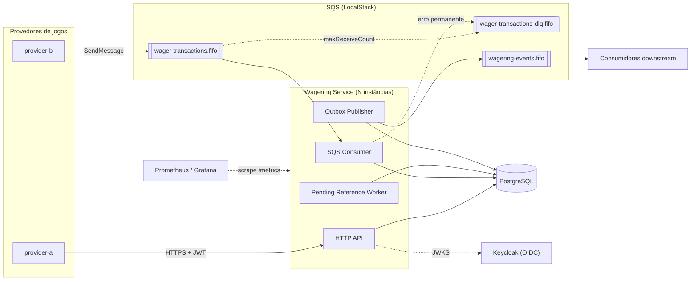

### Implantação local (Docker Compose)

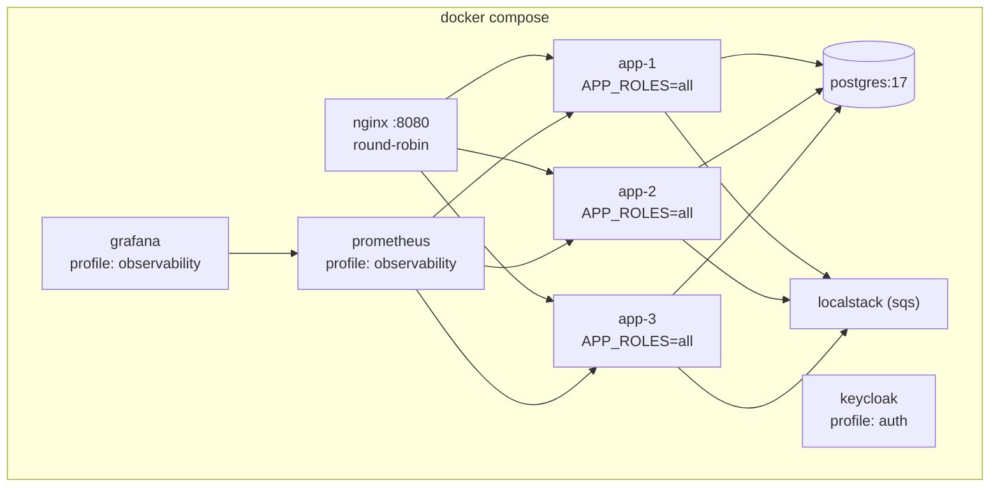

A mesma imagem roda todos os papéis; `APP_ROLES` (`api`, `consumer`, `outbox-publisher`, `pending-reference-worker`) permite separá-los. Três réplicas com todos os papéis é o cenário padrão dos testes multi-instância.

---

## 3. Camadas e módulos

Arquitetura hexagonal (portas e adaptadores) com DDD tático.

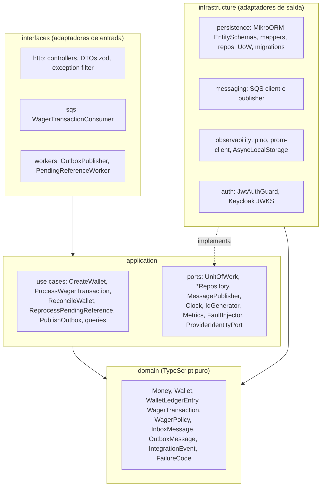

**Regra de dependência:** `domain` não importa nada; `application` importa só `domain`; `infrastructure` e `interfaces` importam ambos. Verificado por lint (restrição de imports) e revisão.

### Estrutura de diretórios

```
src/
  domain/
    shared/        DomainError, tipos utilitários
    money/         Money
    wallet/        Wallet, WalletLedgerEntry, LedgerDirection
    wagering/      WagerTransaction, enums, FailureCode, WagerPolicy
    messaging/     InboxMessage, OutboxMessage, IntegrationEvent + eventos
  application/
    ports/
    use-cases/
    services/      PayloadHasher, TransientRetry
  infrastructure/
    config/  persistence/  migrations/  messaging/  observability/  auth/
  interfaces/
    http/  sqs/  workers/
  app.module.ts
  main.ts
test/
  unit/  integration/  concurrency/  support/
load/              cenários de carga (bun run test:load)
docker/            init do postgres, localstack, realm keycloak, prometheus, grafana
```

---

## 4. Modelo de domínio


### 4.1 `Money`

- Representação interna: **`bigint` em unidades menores (centavos)**, escala fixa 2. Aritmética exata e sem dependência (ADR-002).
- `Money.from({ amount, currency })` é o parser de **contrato de entrada**: aceita somente `^(0|[1-9][0-9]*)\.[0-9]{2}$` (escala exata 2, sem sinal, sem espaços, sem expoente) e moeda `^[A-Z]{3}$`. Rejeita `NaN`, `Infinity`, `1e3`, `""`, `"10.005"`, `"-1.00"`, `"10"`, `"010.00"`. Valor máximo limitado ao `numeric(20,2)`.
- Não existe arredondamento implícito em lugar nenhum: entrada com mais casas é rejeitada, não arredondada.
- Valores negativos só surgem internamente (`negate`, `subtract`) e são serializados com `-`.
- Persistência: `amount numeric(20,2)` + `currency char(3)`; o driver devolve `numeric` como string, o mapper converte string → `Money` sem passar por `number`.

### 4.2 `Wallet`

- `debit`/`credit` recebem `ledgerEntryId`, `transactionId`, `money` e `at`, validam moeda e não-negatividade, atualizam `_balance`, incrementam `_version` e **retornam o `WalletLedgerEntry`** correspondente. Assim, saldo e lançamento nascem juntos e não há como mudar saldo sem lançamento.
- `version = 1` após `open` (inclusive com `OPENING`); `+1` a cada alteração de saldo; `LOSS`, `REJECTED` e `PENDING_REFERENCE` não incrementam.
- `walletVersion` do lançamento = `version` da wallet após a alteração. É a chave de ordenação e o cursor do ledger.

### 4.3 `WagerTransaction` — máquina de estados

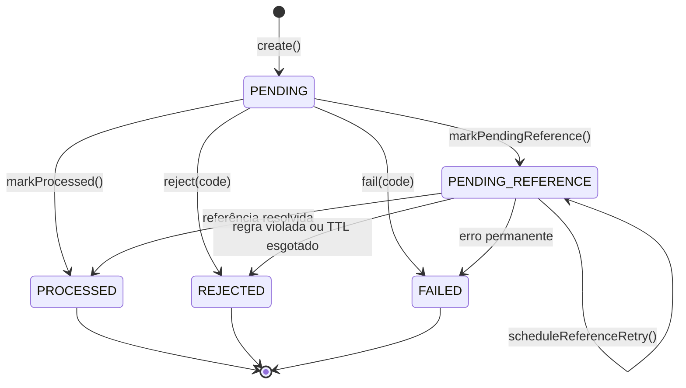

- Qualquer transição a partir de `PROCESSED`, `REJECTED` ou `FAILED` lança `InvalidTransactionStateError` (erro de programação) **e** é bloqueada por trigger no banco.
- `PENDING` existe em memória durante o processamento síncrono; não é persistido no fluxo atual (o schema o aceita para um futuro modo de aceite assíncrono).
- `FAILED` é usado quando o processamento atinge um erro permanente não-negocial: violação de invariante detectada pelo banco (`INVARIANT_VIOLATION`) ou retries de infraestrutura esgotados no worker de pendências (`PROCESSING_RETRIES_EXHAUSTED`). É terminal e auditável.

### 4.4 Regras por operação (`WagerPolicy`)

| Kind | Referência | Efeito | Rejeições possíveis |
|---|---|---|---|
| `OPENING` | — | `CREDIT` | só interno (API/fila → 400 `UNSUPPORTED_KIND`) |
| `BET` | — | `DEBIT` | `INSUFFICIENT_FUNDS` |
| `WIN` | opcional (`BET`) | `CREDIT` | `REFERENCE_MISMATCH` se informada e divergente |
| `LOSS` | opcional (`BET`) | nenhum | idem |
| `REFUND` | obrigatória, `BET` | `CREDIT` | `REFERENCE_KIND_NOT_REVERSIBLE`, `REFERENCE_ALREADY_REVERSED`, `REVERSAL_AMOUNT_MISMATCH`, `REFERENCE_NOT_PROCESSED` |
| `ROLLBACK` | obrigatória, `BET`/`WIN`/`REFUND` | inverso: `BET`→`CREDIT`; `WIN`/`REFUND`→`DEBIT` | as de `REFUND` + `REVERSAL_WOULD_OVERDRAW` |

Validação comum a todos: moeda da operação = moeda da wallet (`CURRENCY_MISMATCH`), `playerId` = dono da wallet (`WALLET_PLAYER_MISMATCH`). Para referência: mesmo provider, player, wallet, moeda e rodada (`REFERENCE_MISMATCH`).

### 4.5 Eventos de integração

| Evento | Quando | `aggregateId` |
|---|---|---|
| `WagerTransactionProcessed` v1 | qualquer transação `PROCESSED`, inclusive `LOSS` | `transactionId` |
| `WagerTransactionRejected` v1 | `REJECTED` (inclui TTL de referência) | `transactionId` |
| `WalletBalanceChanged` v1 | somente quando o saldo muda (inclui `OPENING`) | `walletId` |
| `WagerTransactionPendingReference` v1 | entrou em `PENDING_REFERENCE` | `transactionId` |
| `WalletOpened` v1 *(extra)* | wallet criada | `walletId` |

`data` carrega `MoneyProps` (string), nunca `Money`. `correlationId` vem da requisição/mensagem de origem; `causationId` é o `messageId` (SQS) ou o `Idempotency-Key` (HTTP).

---

## 5. Schema do banco e garantias

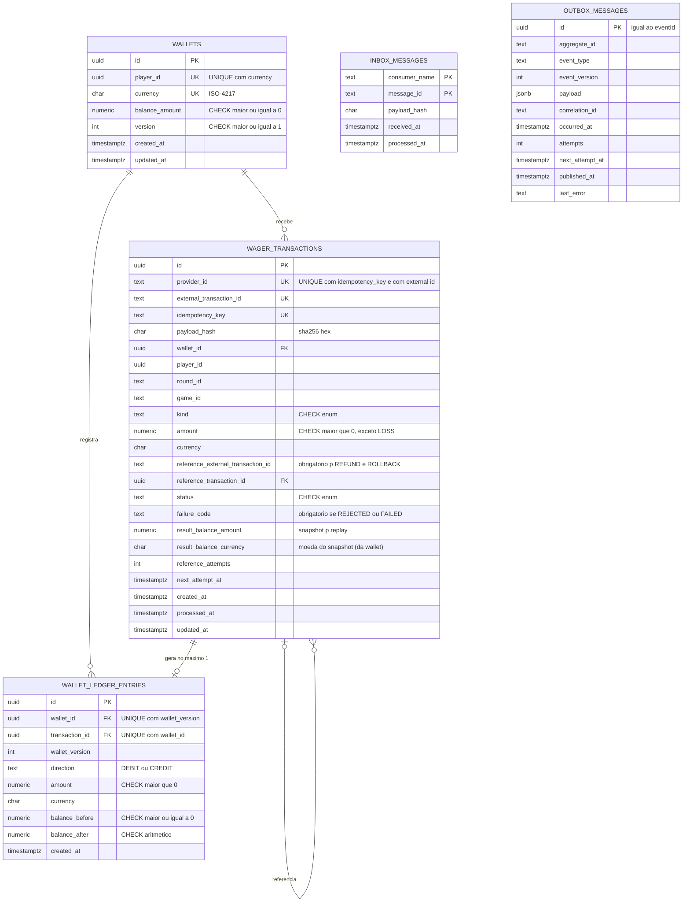

### 5.1 Garantias no schema (restrição 9)

| Garantia | Mecanismo |
|---|---|
| 1 wallet por `player + currency` | `UNIQUE (player_id, currency)` |
| Saldo nunca negativo | `CHECK (balance_amount >= 0)` em `wallets`; `CHECK (balance_after >= 0)` no ledger |
| Idempotência | `UNIQUE (provider_id, idempotency_key)` e `UNIQUE (provider_id, external_transaction_id)` |
| Referência obrigatória | `CHECK (kind NOT IN ('REFUND','ROLLBACK') OR reference_external_transaction_id IS NOT NULL)` |
| Uma reversão efetiva por referência | `UNIQUE (reference_transaction_id) WHERE status = 'PROCESSED' AND kind IN ('REFUND','ROLLBACK')` |
| Um `OPENING` por wallet | `UNIQUE (wallet_id) WHERE kind = 'OPENING'` |
| Rejeição auditável | `CHECK (status NOT IN ('REJECTED','FAILED') OR failure_code IS NOT NULL)` |
| Terminal é terminal | trigger `BEFORE UPDATE` em `wager_transactions` recusa mudança de `status` (e de colunas de negócio) se `OLD.status` é terminal |
| ≤ 1 lançamento por transação por wallet | `UNIQUE (transaction_id, wallet_id)` |
| Aritmética do lançamento | `CHECK ((direction='CREDIT' AND balance_after = balance_before + amount) OR (direction='DEBIT' AND balance_after = balance_before - amount))` |
| Ledger imutável | trigger `BEFORE UPDATE OR DELETE` → `RAISE EXCEPTION`; `REVOKE UPDATE, DELETE, TRUNCATE` do role `wallet_app` |
| Ledger encadeado | trigger `BEFORE INSERT`: `balance_before` = `balance_after` do lançamento anterior da wallet (ou 0) e `wallet_version` = anterior + 1 (sem buracos); `UNIQUE (wallet_id, wallet_version)` |
| **Saldo == ledger** | `CONSTRAINT TRIGGER … DEFERRABLE INITIALLY DEFERRED` em `wallets` **e** no ledger: no COMMIT, relê a wallet e exige `balance_amount`/`version` iguais ao `balance_after`/`wallet_version` do último lançamento (sem lançamentos: saldo 0 e versão 1) |
| Lançamento ⇔ transação aplicada | dois constraint triggers diferidos: todo lançamento aponta para uma transação `PROCESSED` de mesmo valor (nunca `LOSS`/`REJECTED`), e toda transação `PROCESSED` que move dinheiro tem seu lançamento |
| Lançamento na wallet e moeda certas | FKs compostas `(wallet_id, currency) → wallets (id, currency)` e `(transaction_id, wallet_id) → wager_transactions (id, wallet_id)` |
| Coerência status × colunas | `CHECK`s: `failure_code` ⇔ `REJECTED/FAILED`; `processed_at` ⇔ terminal; `next_attempt_at` ⇔ `PENDING_REFERENCE`; snapshot de saldo obrigatório fora de `PENDING/FAILED`; reversão `PROCESSED` com referência resolvida; `BET`/`OPENING` sem referência; `OPENING` só do provider `internal` |
| Histórico nunca apagado | triggers `BEFORE DELETE`/`TRUNCATE` em `wager_transactions` e `inbox_messages`; o role da app não tem `DELETE` em nenhuma tabela |
| Inbox única | `PRIMARY KEY (consumer_name, message_id)` |
| Outbox só avança | trigger: evento (tipo, versão, payload) imutável, `attempts` não decresce, mensagem publicada congelada; `CHECK` publicada ⇔ sem `next_attempt_at` |

Roles: `wallet_owner` é dono das tabelas e roda migrations; `wallet_app` (runtime) tem apenas `SELECT, INSERT` no ledger e `SELECT, INSERT, UPDATE` nas demais. Triggers protegem inclusive contra o owner.

Cada linha desta tabela tem um teste em `test/integration/persistence/schema-constraints.test.ts` que tenta violá-la direto via SQL e exige o SQLSTATE e o nome da constraint. Remover qualquer uma das garantias faz o teste correspondente falhar (verificado com mutações durante o Sprint 2).

### 5.2 Índices operacionais

- `wager_transactions (next_attempt_at) WHERE status = 'PENDING_REFERENCE'` — varredura do worker.
- `wager_transactions (provider_id, reference_external_transaction_id) WHERE status = 'PENDING_REFERENCE'` — "nudge" quando a referência chega.
- `wallet_ledger_entries (wallet_id, wallet_version DESC)` — cursor e encadeamento (coberto pelo UNIQUE).
- `outbox_messages (next_attempt_at) WHERE published_at IS NULL` — publisher.

Migrations: MikroORM Migrator com SQL explícito (`up`/`down`) — triggers e índices parciais escritos à mão, não gerados. Testadas com `up → down → up`.

---

## 6. Concorrência

**Estratégia: lock pessimista de linha por wallet + versão como segunda barreira + CHECK no banco como terceira** (ADR-003).

```sql
BEGIN;                                   -- READ COMMITTED
SET LOCAL lock_timeout = '2s';
SET LOCAL statement_timeout = '5s';
SELECT * FROM wallets WHERE id = $1 FOR UPDATE;           -- serializa só esta wallet
SELECT * FROM wager_transactions
 WHERE provider_id = $2 AND idempotency_key = $3;         -- já enxerga commits concorrentes
-- ... domínio decide ...
INSERT INTO wager_transactions ...;                       -- antes do lançamento (FK composta)
INSERT INTO wallet_ledger_entries ...;                    -- trigger confere o encadeamento
UPDATE wallets SET balance_amount = $4, version = $6, updated_at = $7
 WHERE id = $1 AND version = $5;                          -- 1 linha ou ConcurrencyConflictError
INSERT INTO outbox_messages ...;
COMMIT;                                                   -- triggers diferidos validam saldo == ledger
```

Por que **READ COMMITTED**: após obter o lock, cada nova instrução enxerga o último estado confirmado. Isso torna a checagem de idempotência e de "já revertida" correta sem `SERIALIZABLE` (que geraria falhas de serialização em massa numa hot wallet).

### Cenário obrigatório — 100.00 BRL, duas apostas de 80.00

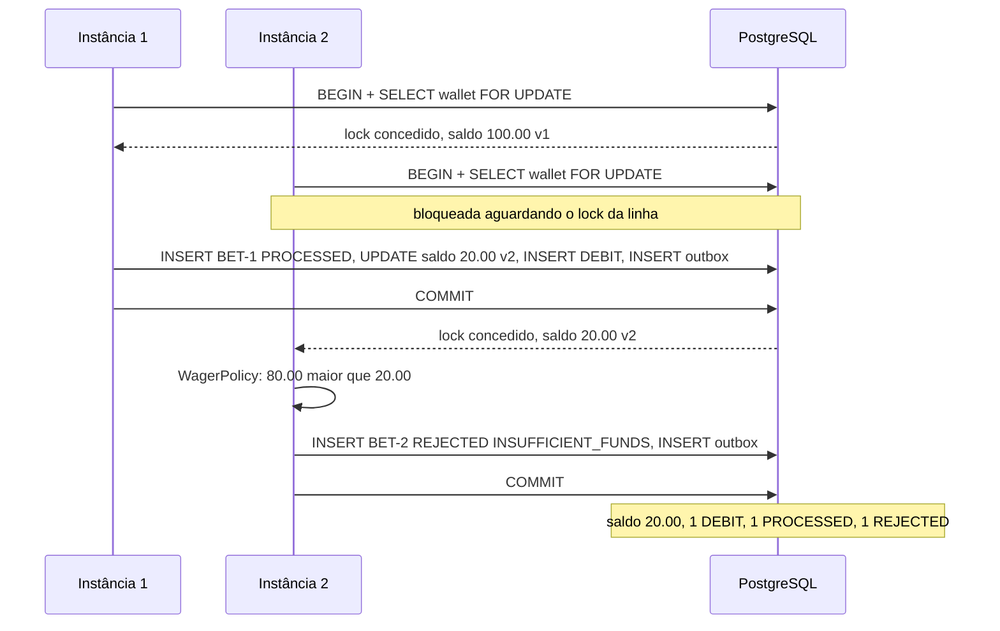

### Ordem global de locks (evita deadlock)

`inbox_messages` (insert) → `wallets` (FOR UPDATE) → `wager_transactions` (referência / pendentes) → inserts.
Cada transação toca **uma única wallet**, então não há ciclo entre wallets. O worker de pendências segue a mesma ordem: lê candidatos sem lock, depois `wallet FOR UPDATE` e só então `tx FOR UPDATE SKIP LOCKED`.

### Retry de erros transitórios

`40P01` (deadlock), `55P03` (lock timeout), `40001` (serialization), `OptimisticLockError` e perda de conexão → até 3 tentativas (classificação pelo SQLSTATE em `err.code`, ver §13.1) com backoff exponencial + jitter. Esgotado: HTTP 503 `Retry-After`; SQS não dá ack. `23505` em `uq_tx_idempotency` (duas instâncias inserindo a mesma key em wallets diferentes) → reexecuta uma vez e cai no caminho de replay/conflito.

**Hot wallet:** o lock serializa as operações dela; throughput por wallet ≈ 1 / latência da transação. Wallets diferentes não competem. Medido no teste de carga.

---

## 7. Idempotência

Três camadas, todas persistentes:

| Camada | Chave | Protege contra |
|---|---|---|
| Inbox (só SQS) | `(consumer_name, message_id)` | redelivery da mesma mensagem |
| Idempotency key | `(provider_id, idempotency_key)` | mesma operação por canais/mensagens diferentes |
| External id | `(provider_id, external_transaction_id)` | key diferente para a mesma operação do provedor |

**`payloadHash`** = `sha256_hex(canonicalJson(subset))`, onde `subset` contém apenas campos de negócio: `providerId, externalTransactionId, playerId, walletId, roundId, gameId, kind, money{amount,currency}, referenceExternalTransactionId` (omitido se ausente). `canonicalJson` ordena chaves recursivamente, sem espaços, UTF-8. Header, `messageId`, `occurredAt` e metadados de transporte **não** entram. Como `amount` é validado com escala exata, a string já é canônica.

Resultado de uma submissão repetida:

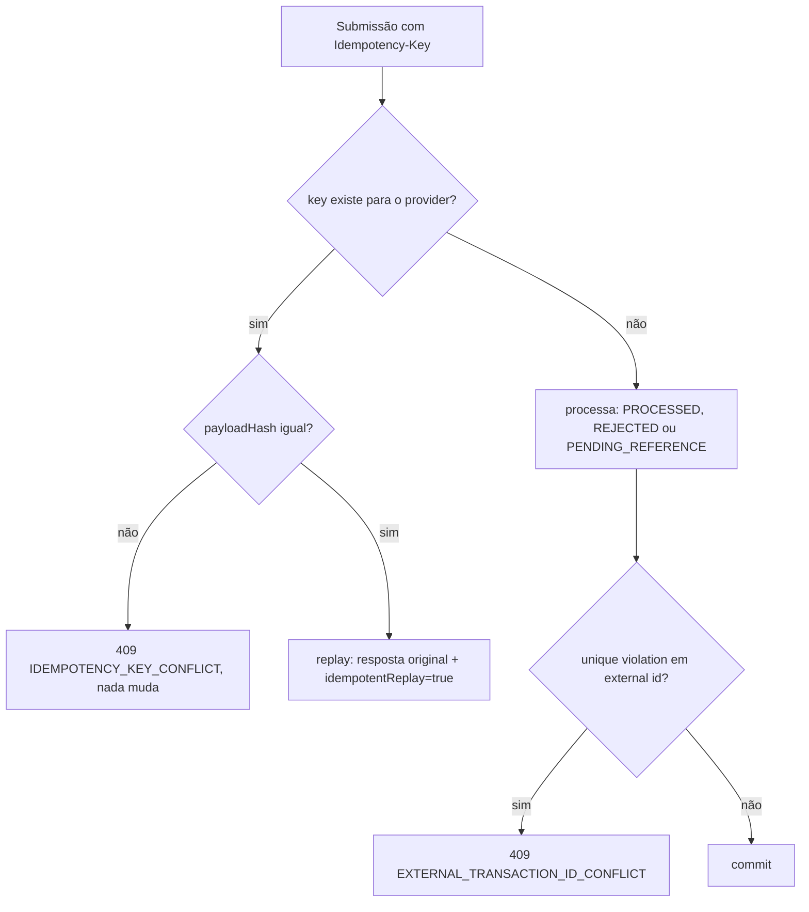

O replay usa o snapshot persistido (`status`, `failure_code`, `result_balance_amount`/`result_balance_currency`), por isso devolve o saldo observado no momento do processamento original.

---

## 8. Fluxos principais

### 8.1 Submissão via HTTP

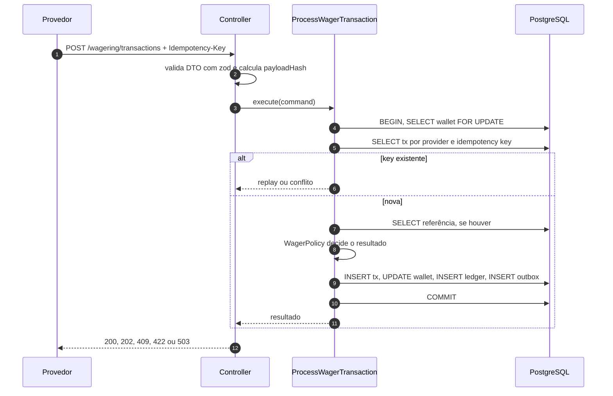

### 8.2 Consumo SQS com inbox

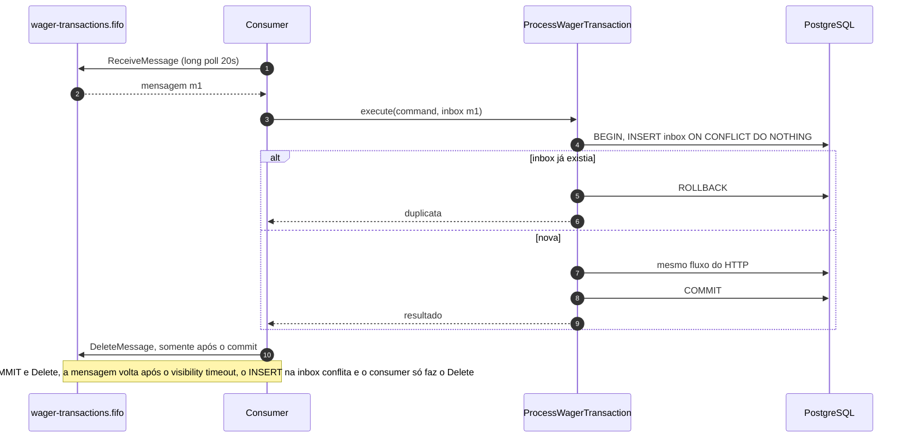

Classificação de erros do consumer:

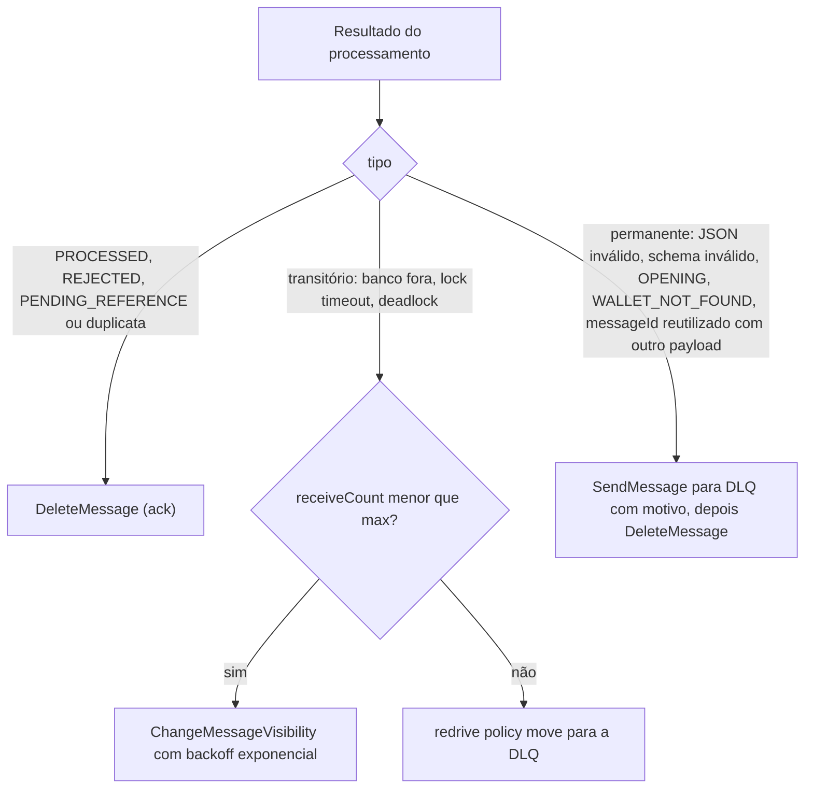

Princípio: **o que pode ser representado no domínio vira `REJECTED` auditável e recebe ack; o que não pode vai para a DLQ, que funciona como trilha de auditoria.**

`SIGTERM`: o loop para de chamar `ReceiveMessage` (abort do long poll), mensagens do lote ainda não iniciadas recebem `ChangeMessageVisibility 0`, as em andamento terminam dentro de `SHUTDOWN_GRACE_MS` (menor que o `stop_grace_period` do Compose). Readiness responde 503 assim que o shutdown começa.

### 8.3 Outbox publisher (vários publishers)

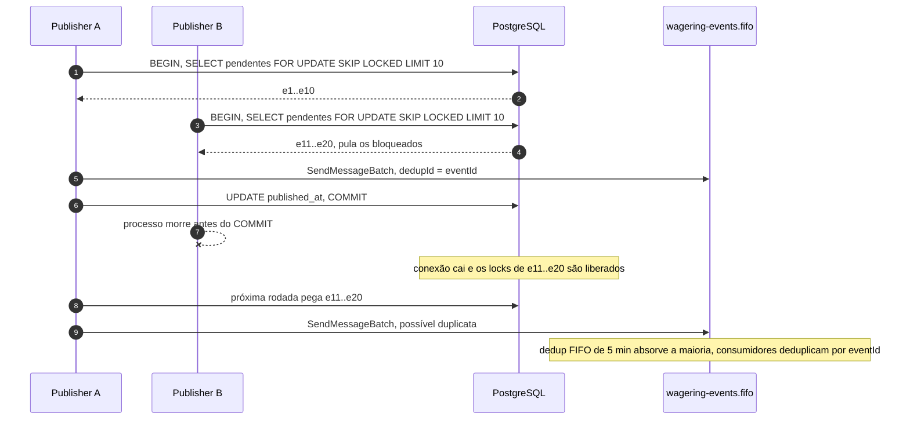

- Falha de publish → `scheduleRetry`: `attempts + 1`, `next_attempt_at = now + min(1s * 2^attempts, 5min)`, sem jitter (backoff determinístico no domínio; publishers concorrentes já se evitam com `SKIP LOCKED`). Nunca descarta: um evento confirmado não se perde (métrica e alerta para `attempts` alto).
- Cenário do desafio (commit → crash → outra instância publica → duplicata segura) é coberto porque a outbox é gravada na transação financeira e a publicação é at-least-once com `eventId` estável.
- Ordem: publishers concorrentes podem inverter eventos da mesma wallet. Consumidores ordenam por `walletVersion` (presente em `WalletBalanceChanged`). Ver limitações.

### 8.4 Referência fora de ordem (`PENDING_REFERENCE`)

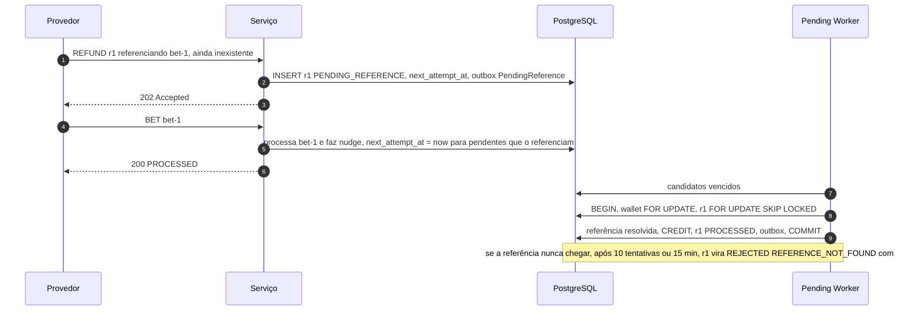

Backoff: `1s, 2s, 4s … teto 5 min`, no máximo **10 tentativas ou TTL de 15 min** (o que vier primeiro), configuráveis. Justificativa: provedores normalmente reenviam a operação original em segundos/minutos; manter pendências por mais tempo distorce a reconciliação e o saldo exibido ao jogador. O nudge torna a latência independente do backoff no caso comum.

### 8.5 Criação de wallet e reconciliação

- `POST /wallets`: numa transação, `INSERT wallet (v1)`; se `initialBalance > 0`, `INSERT wager_transactions (OPENING, PROCESSED)` + `INSERT ledger (CREDIT, v1)` + outbox `WalletOpened` e `WalletBalanceChanged`. Resposta 201. Duplicata → `23505` em `uq_wallets_player_currency` → 409 `WALLET_ALREADY_EXISTS`.
- `GET /wallets/:id/ledger`: mais recentes primeiro, keyset por `wallet_version`. O cursor é opaco (`base64url` de `{walletId, version}`): estável porque o ledger é imutável e a versão é monotônica, e recusado (400) se usado em outra wallet. `limit` entre 1 e 200, padrão 50.
- `POST /wallets/:id/reconciliation`: transação `REPEATABLE READ READ ONLY` (snapshot consistente, sem bloquear escritores): `calculated = Σ CREDIT − Σ DEBIT`; compara com `balance_amount` e com o `balance_after` do último lançamento. Divergência → log `error` com `walletId`, métrica `wallet_reconciliation_divergences_total`, `consistent: false`. Nada é corrigido.

---

## 9. Contratos: HTTP e failure codes

### 9.1 Mapeamento de status (consistente em todos os endpoints)

| Situação | HTTP | Corpo | Provedor deve |
|---|---|---|---|
| Processada (nova ou replay) | **200** | `{transactionId, status: PROCESSED, balance, idempotentReplay}` | seguir |
| Aceita, aguardando referência | **202** | `status: PENDING_REFERENCE` | consultar depois / aguardar evento |
| Payload inválido / header ausente | **400** | problem+json `VALIDATION_ERROR` + detalhes | corrigir payload |
| Não autenticado / provider divergente do token | **401 / 403** | `UNAUTHENTICATED` / `PROVIDER_MISMATCH` | corrigir credencial |
| Recurso da URL inexistente (consultas) | **404** | `NOT_FOUND` | — |
| Conflito de idempotência / external id / wallet duplicada | **409** | `IDEMPOTENCY_KEY_CONFLICT`, `EXTERNAL_TRANSACTION_ID_CONFLICT`, `WALLET_ALREADY_EXISTS` | **não** reenviar igual |
| Rejeição de regra de negócio | **422** | `{transactionId, status: REJECTED, failureCode, balance, idempotentReplay}` | desistir ou corrigir |
| Falha transitória | **503** + `Retry-After` | `retryable: true` | reenviar a mesma requisição |
| Falha permanente (`FAILED`) / inesperada | **500** | `retryable: false` | escalar |

Erros seguem `application/problem+json` (RFC 9457) com `code` e `retryable`. Replay devolve o **mesmo** status e corpo do original, com `idempotentReplay: true`.

### 9.2 Taxonomia de `failureCode`

| Código | Categoria | Persistido? | Ação sugerida |
|---|---|---|---|
| `INSUFFICIENT_FUNDS` | negócio | `REJECTED` | desistir |
| `REVERSAL_WOULD_OVERDRAW` | negócio | `REJECTED` | escalar (operacionalmente diferente de aposta sem saldo) |
| `CURRENCY_MISMATCH` | negócio | `REJECTED` | corrigir payload |
| `WALLET_PLAYER_MISMATCH` | negócio | `REJECTED` | corrigir payload |
| `REFERENCE_NOT_FOUND` | negócio | `REJECTED` (após TTL) | reenviar a referência e depois a reversão com nova key |
| `REFERENCE_MISMATCH` | negócio | `REJECTED` | corrigir payload |
| `REFERENCE_KIND_NOT_REVERSIBLE` | negócio | `REJECTED` | corrigir payload |
| `REFERENCE_NOT_PROCESSED` | negócio | `REJECTED` | desistir |
| `REFERENCE_ALREADY_REVERSED` | negócio | `REJECTED` | desistir (já aplicado) |
| `REVERSAL_AMOUNT_MISMATCH` | negócio | `REJECTED` | corrigir payload |
| `WALLET_NOT_FOUND` | negócio | não (sem agregado) | corrigir payload |
| `VALIDATION_ERROR`, `INVALID_MONEY`, `UNSUPPORTED_KIND`, `MISSING_REFERENCE` | validação | não | corrigir payload |
| `IDEMPOTENCY_KEY_CONFLICT`, `EXTERNAL_TRANSACTION_ID_CONFLICT` | conflito | não | não reenviar |
| `DATABASE_UNAVAILABLE`, `LOCK_TIMEOUT`, `CONCURRENCY_CONFLICT`, `BROKER_UNAVAILABLE` | transitório | não | reenviar igual |
| `INVARIANT_VIOLATION`, `PROCESSING_RETRIES_EXHAUSTED` | permanente | `FAILED` | escalar |

---

## 10. Observabilidade

**Logs** (pino, JSON): contexto via `AsyncLocalStorage` com `correlationId`, `messageId`, `transactionId`, `walletId`, `providerId`, `kind`, `status`, `failureCode`. `redact` para `money`, `balance*`, `amount` e headers de autenticação. Payload completo nunca é logado.

**Métricas** (prom-client, `GET /metrics`):

| Métrica | Tipo | Labels |
|---|---|---|
| `wagering_transactions_total` | counter | `kind`, `status`, `source` (http/sqs/worker) |
| `wagering_processing_duration_seconds` | histogram | `kind`, `source`, `outcome` |
| `wagering_idempotent_replays_total` / `wagering_idempotency_conflicts_total` | counter | `source` |
| `inbox_duplicates_total` | counter | `consumer` |
| `processing_retries_total` | counter | `reason` |
| `db_lock_conflicts_total` | counter | `type` (lock_timeout, deadlock, serialization, version) |
| `sqs_dlq_messages_total` | counter | `reason` |
| `sqs_dlq_depth` | gauge | `queue` |
| `outbox_pending_messages` / `outbox_lag_seconds` | gauge | — |
| `outbox_publish_total` | counter | `result` |
| `pending_reference_transactions` | gauge | — |
| `wallet_reconciliation_divergences_total` | counter | — |

**Health:** `/health/live` (processo responde) e `/health/ready` (`SELECT 1` + `GetQueueAttributes`; 503 durante shutdown). Ambos sem autenticação.

**Opcional:** Prometheus + Grafana no profile `observability`; OpenTelemetry se compatível com Bun.

---

## 11. Autenticação

Vale 0 pontos — implementada com timebox no Sprint 6, com ponto de extensão desde o início.

- **IdP:** Keycloak (realm importado no boot do Compose).
- **Provedores:** um client confidencial por provedor, fluxo `client_credentials`, claim `provider_id` via mapper.
- **Backoffice:** role `wallet-admin` exigida em `POST /wallets` e reconciliação.
- **Aplicação:** `JwtAuthGuard` valida assinatura (JWKS via `jose`), `iss`, `aud` e `exp`. `ProviderIdentityPort` expõe o provedor autenticado; o use case exige `body.providerId == token.provider_id` (`403 PROVIDER_MISMATCH`).
- **Fila:** canal interno confiável, mas o `providerId` da mensagem passa pelas mesmas validações de domínio (referência do mesmo provider etc.).
- `AUTH_MODE=disabled` troca o guard por um no-op (testes e desenvolvimento). Health e `/metrics` ficam abertos.

**Ponto de extensão já no código** (o que o §2 do desafio exige mesmo sem IdP):

| Peça | Arquivo | Hoje | Sprint 6 |
|---|---|---|---|
| `ProviderIdentityPort` + `Principal` (`trusted` / `provider` / `backoffice`) | `src/application/ports/identity.ts` | contrato | inalterado |
| Adaptador de identidade | `src/infrastructure/auth/` | `TrustedProviderIdentity` (todo chamador é `trusted`) | adaptador Keycloak (JWKS) |
| `AuthGuard` global + `@Public()` | `src/interfaces/http/auth/auth.guard.ts` | resolve o principal e o anexa à requisição; health é `@Public()` | inalterado |
| `AUTH_MODE` | config | só `disabled` é aceito | `keycloak` |
| `401 UNAUTHENTICATED` | filtro de problemas | mapeado | inalterado |

A autorização (provider do token × `providerId` do payload, rotas só de backoffice) fica nos casos de uso, que recebem o `Principal`.

---

## 12. Estratégia de testes

| Suíte | Infra | Como garante determinismo |
|---|---|---|
| `test:unit` | nenhuma | domínio puro, `Clock` e `IdGenerator` falsos |
| `test:integration` | PostgreSQL e LocalStack reais (Compose) | banco novo por arquivo via `CREATE DATABASE … TEMPLATE`; fila com sufixo único por teste |
| `test:concurrency` | idem + processos reais | `Promise.all` com pools independentes, `Bun.spawn` de ≥ 3 instâncias, `FaultInjector` para crash em pontos exatos, `waitFor` com timeout em vez de `sleep` |
| `test:load` | Compose com 3 réplicas | ver `docs/LOAD_TEST.md` |

Todo teste de integração ou concorrência que cria wallets ou move dinheiro termina com `assertLedgerConsistency(databaseUrl, walletIds?)` (`test/support/ledger-consistency.ts`), que verifica, com aritmética em `numeric` no próprio PostgreSQL: `wallet.balance == Σ CREDIT − Σ DEBIT`, último lançamento igual a saldo e versão, e sequência de versões sem buracos. Testes que não tocam em wallets (health, migrations, spike do ORM) não o chamam. A verificação de outbox sem perda (eventos esperados presentes) entra com o publisher, no Sprint 4.

**Crash injection:** `FaultInjector` é uma porta; em produção é no-op. Em teste, `FAULT_POINTS=after-commit-before-ack` faz o processo se matar com `SIGKILL` naquele ponto. Testes de sinal rodam em Linux (container/CI/WSL2).

---

## 13. Registro de decisões (ADRs)

| ADR | Decisão | Alternativas | Motivo |
|---|---|---|---|
| 001 | **MikroORM 7** com `EntitySchema` + mappers para o domínio (validado no Sprint 0, ver §13.1) | TypeORM; decorators nas classes de domínio | preferencial no desafio; `em.transactional()` e `LockMode` explícitos; `EntitySchema` mantém o domínio sem decorators e permite construtores privados |
| 002 | `Money` em **`bigint` de centavos** | `decimal.js`, `big.js` | escala fixa 2 → inteiro é exato, nativo, sem dependência; só há soma/subtração |
| 003 | **Lock pessimista por wallet** (`FOR UPDATE`) + `version` + `CHECK` | só optimistic com retry; update atômico condicionado | hot wallets geram tempestade de retries no optimistic; o update condicionado sozinho não cobre a checagem de idempotência e de reversão única na mesma seção crítica |
| 004 | **READ COMMITTED** | REPEATABLE READ / SERIALIZABLE | o lock já serializa por wallet; níveis maiores só adicionam falhas de serialização |
| 005 | Outbox com **`FOR UPDATE SKIP LOCKED`** dentro de transação curta | lease com `locked_until` | crash libera o lock automaticamente; simples de raciocinar. Custo: conexão presa durante o `SendMessageBatch` (lote pequeno + timeout) |
| 006 | Idempotência **no banco** com escopo por provider | tabela separada de idempotency keys | a própria `wager_transactions` guarda key, hash e snapshot da resposta: uma linha, uma verdade |
| 007 | Garantia **saldo == ledger** por constraint trigger diferido | só reconciliação | converte a invariante central em erro de COMMIT, não em descoberta posterior |
| 008 | Mesma imagem, papéis por `APP_ROLES` | serviços separados | simplicidade local; escala por papel em produção |
| 009 | Validação com **zod** | class-validator | parsing estrito e tipado, também usado para config e mensagens SQS |
| 010 | Infra de teste via **Compose** + banco por arquivo de teste clonado de um template migrado | testcontainers; truncar tabelas entre testes | menos atrito com Bun; mesma infra no CI; clonar template é rápido e não exige `DELETE` (que o role da app nem tem) |
| 011 | CLI de migration próprio (`scripts/migrate.ts`) sobre `orm.migrator`, com `migrationsList` explícito | CLI do MikroORM | roda direto no Bun sem ts-node/descoberta de arquivos; migrations são SQL escrito à mão, sem geração por diff |
| 012 | Dois roles: `wallet_owner` (migrations) e `wallet_app` (runtime) | um único usuário | o runtime não consegue `DELETE`, `TRUNCATE` nem DDL; reforça ledger append-only (R-05) além dos triggers |
| 013 | MikroORM para transação, conexão, metadata (`EntitySchema`), consultas e locks; **escritas financeiras explícitas** (`em.insert`, `em.nativeUpdate … WHERE version = ?`) em ordem fixa; leituras com `disableIdentityMap` | Unit of Work com dirty-checking e `flush()` | a ordem dos statements importa (triggers, FKs compostas, ordem de locks) e o update de saldo precisa do guard de versão com contagem de linhas afetadas; o identity map serviria uma linha relida depois de uma escrita explícita como cópia velha |

### 13.1 Resultados do spike do Sprint 0

Versões resolvidas: Bun 1.4.4, NestJS 12, MikroORM 7.2, TypeScript 7 (`tsc` nativo), zod 4, Biome 2.6, PostgreSQL 17, LocalStack 4.

| Verificação | Resultado | Evidência |
|---|---|---|
| NestJS 12 roda sob Bun com decorators e `emitDecoratorMetadata` | ok | `test/integration/http/health.test.ts` |
| `EntitySchema` com classe de persistência sem decorators | ok | `mikro-orm-spike.test.ts` |
| `em.transactional()` + `LockMode.PESSIMISTIC_WRITE` serializa 20 escritores concorrentes sem lost update | ok | idem |
| `SET LOCAL lock_timeout` dentro da transação | ok, mas o erro chega como `DriverException` genérica com `code: '55P03'`: o conversor do MikroORM 7 para PostgreSQL **não** mapeia lock timeout para `LockWaitTimeoutException` | idem |
| `numeric(20,2)` volta como string exata (`'999999999999999999.99'`) | ok | idem |
| Migrations `up → down → up` via `orm.migrator` sob Bun | ok | `migrations.test.ts` e CI |
| TypeScript 7 removeu `baseUrl` | aliases de caminho abandonados; imports relativos | `tsconfig.json` |

**Consequência para o Sprint 3:** a classificação de erros transitórios (§6) é feita pelo **SQLSTATE** (`err.code`), não pela classe da exceção.

---

## 14. Interpretações das regras

| # | Interpretação | Justificativa |
|---|---|---|
| I-01 | Uma referência admite **no máximo uma reversão efetiva**, independentemente do tipo (`REFUND` ou `ROLLBACK`) | a regra 4 fala "pelo mesmo tipo", mas `REFUND` + `ROLLBACK` sobre a mesma `BET` creditaria duas vezes — viola a invariante de não duplicar créditos. `ROLLBACK` de um `REFUND` continua permitido (é outra referência) |
| I-02 | `WIN`/`LOSS` com referência informada passam pela mesma validação; referência ausente → `PENDING_REFERENCE` | consistência com `REFUND`/`ROLLBACK` |
| I-03 | `BET` que chega depois de sua reversão pendente é processada normalmente (sem "tombstone") | segue o fluxo pedido no desafio; o efeito líquido é zero |
| I-04 | `WALLET_NOT_FOUND` não é persistido (sem agregado a que pertencer): HTTP 422; SQS → DLQ | a DLQ é a trilha de auditoria do que não cabe no domínio |
| I-05 | `amount` exige escala exata de 2 casas (`"25.00"`, não `"25"`) | o contrato diz "sempre com escala fixa de 2 casas" |
| I-06 | `LOSS` aceita `0.00`; demais kinds exigem valor > 0 | `LOSS` não move saldo |
| I-07 | Replay de `PENDING_REFERENCE` devolve o estado atual da transação | o "resultado original" se aplica a transações terminais |
| I-08 | `ROLLBACK` de `LOSS` e de `ROLLBACK` → `REFERENCE_KIND_NOT_REVERSIBLE` | `LOSS` não tem efeito; reverter reversão abre ciclo |
| I-09 | Referência `REJECTED`/`FAILED` → `REFERENCE_NOT_PROCESSED`; referência em `PENDING_REFERENCE` → continua pendente | só se reverte o que foi aplicado |
| I-10 | Mesmo `messageId` com payload diferente → DLQ + métrica | indica bug do produtor, não replay |
| I-11 | Idempotency key tem escopo por `providerId` | evita colisão entre provedores |
| I-12 | `BET` não aceita `referenceExternalTransactionId` (400 `VALIDATION_ERROR`) | aposta abre a rodada; não há o que referenciar |
| I-13 | `WIN`/`LOSS` com referência que não é uma `BET` → `REFERENCE_MISMATCH` | o resultado de rodada só liquida uma aposta; `REFERENCE_KIND_NOT_REVERSIBLE` fica reservado às reversões |

---

## 15. Matriz de falhas

| Falha | Comportamento | Teste |
|---|---|---|
| Processo morre antes do COMMIT | rollback total; HTTP sem resposta → provedor reenvia; SQS reentrega | T-I02 |
| Processo morre após COMMIT, antes do ack | reentrega → inbox conflita → só ack | T-C05 |
| Processo morre após COMMIT, antes de publicar | outbox pendente → outra instância publica | T-I06, T-C06 |
| Publisher morre após publicar, antes de marcar | republica; dedup por `eventId` | T-C06 |
| PostgreSQL indisponível | 503 + `Retry-After`; consumer sem ack; readiness 503 | S5-05 |
| SQS indisponível | HTTP continua; outbox acumula e drena; consumer em backoff | S5-05 |
| Mesma mensagem em paralelo em N instâncias | `INSERT inbox` bloqueia no índice único até a primeira confirmar | T-C01, T-C04 |
| Referência chega depois | `PENDING_REFERENCE` + worker + nudge | T-C07 |
| Lock timeout / deadlock | retry limitado → 503 / backoff na fila | T-C02 |
| `SIGTERM` | drena HTTP, conclui ou devolve mensagens, encerra workers e pool | S5-08 |

---

## 16. Trade-offs e limitações

- **Throughput por hot wallet** é limitado pela serialização no lock — escolha consciente: correção acima de paralelismo dentro da mesma wallet.
- **Ordem de eventos** entre publishers concorrentes não é garantida; consumidores devem usar `walletVersion` e deduplicar por `eventId`.
- **Reconciliação** soma o ledger inteiro; wallets muito longas pediriam checkpoints de saldo.
- **Outbox** guarda eventos publicados indefinidamente (auditoria); em produção, particionar/arquivar.
- **Pendências** com TTL de 15 min podem rejeitar reversões de provedores muito lentos (configurável).
- **Moeda**: modelo multi-moeda, mas escala fixa em 2 casas para todas.
- **SQS FIFO** bloqueia o message group (wallet) enquanto uma mensagem está em backoff — preserva a ordem por wallet ao custo de latência.

*Este documento é atualizado a cada sprint; mudanças de decisão entram como nova linha nos ADRs.*
