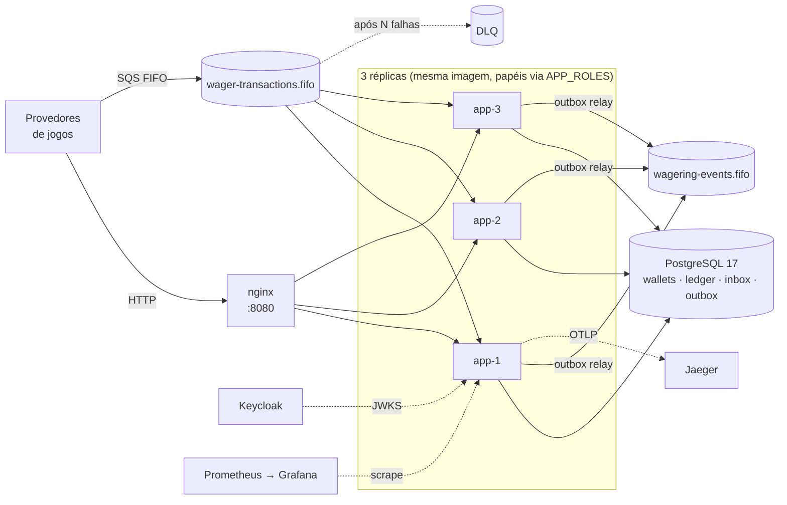
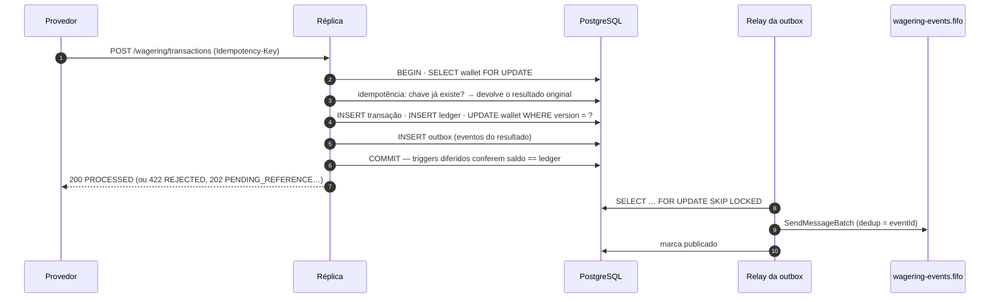
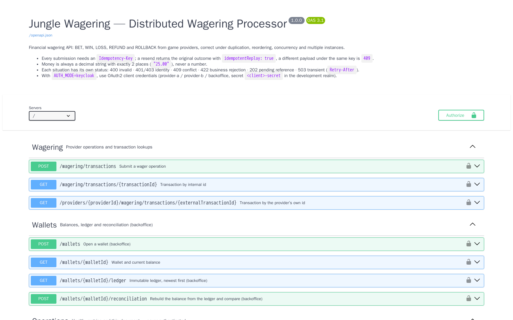
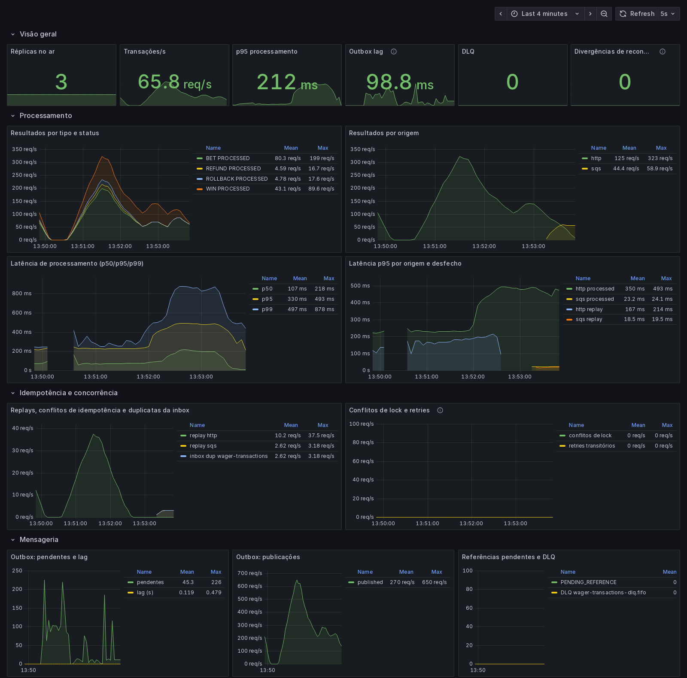
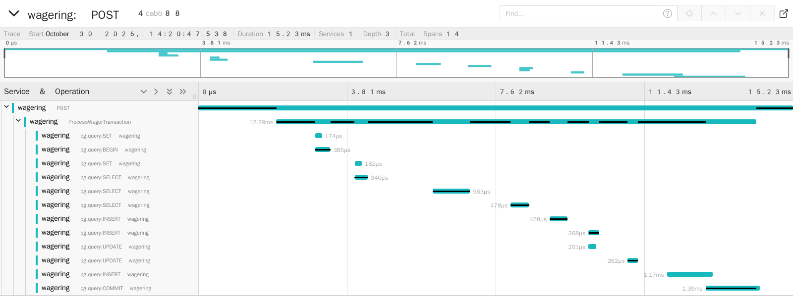
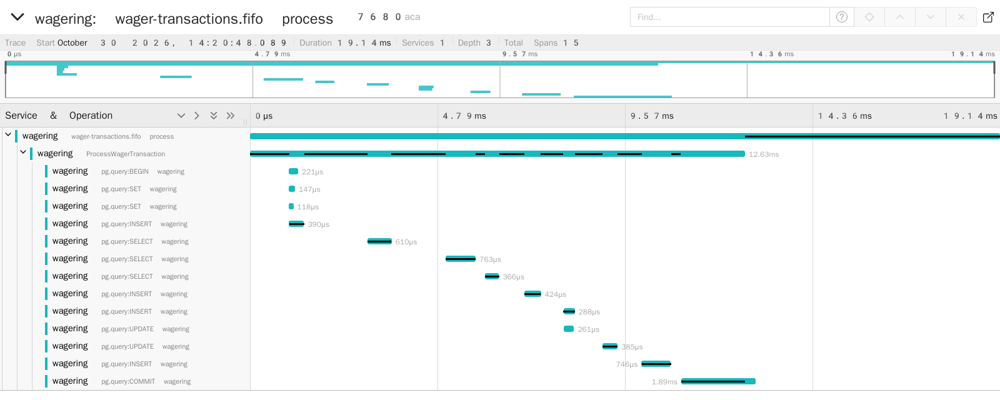

# Jungle Wagering — Distributed Wagering Processor

[](https://github.com/RodrigoTorreao/jungle-backend/actions/workflows/ci.yml)


Serviço financeiro que processa operações de apostas (`BET`, `WIN`, `LOSS`, `REFUND`, `ROLLBACK`) vindas de provedores de jogos por **HTTP** e **SQS**. Ele permanece **financeiramente correto** com mensagens duplicadas, fora de ordem, concorrentes e várias instâncias, e também quando processos morrem no meio do caminho.

> Nunca duplica crédito ou débito, nunca perde um evento confirmado, nunca deixa saldo negativo. Cada uma dessas garantias está **no schema do banco** e é **provada por teste** com PostgreSQL e SQS reais, paralelismo real e processos reais sendo mortos.

---

## Destaques

| | |
|---|---|
| 🧱 **Garantias no banco de dados** | `saldo == Σ ledger` verificado no `COMMIT` por *constraint trigger* diferido; lançamentos encadeados (`balance_before` = `balance_after` anterior), imutáveis por trigger e sem `UPDATE`/`DELETE` para o role da aplicação; `CHECK (saldo ≥ 0)`; unicidade de idempotência e de inbox por índice |
| 🔁 **Idempotência persistente** | chave por provedor + hash canônico do payload + snapshot da resposta: reenvio devolve o resultado original; mesma chave com outro payload é `409`. Nenhum cache em memória |
| 🔒 **Concorrência por wallet** | `SELECT … FOR UPDATE` na linha da wallet, guarda de versão e ordem global de locks (sem deadlock, sem lock global). Hot wallet com 32 requisições simultâneas: **zero** lock timeouts |
| 📬 **Mensageria at-least-once correta** | inbox e outbox na mesma transação SQL do efeito financeiro; relay com `FOR UPDATE SKIP LOCKED` e envio paralelo que preserva a ordem por wallet; DLQ, backoff, referências fora de ordem resolvidas por worker |
| 💥 **Provado com processos reais** | 3 instâncias disputando as mesmas wallets; `SIGKILL` em pontos exatos (antes do commit, entre commit e ack, entre publicar e marcar); `SIGTERM` drenando o trabalho em andamento; quedas de PostgreSQL e SQS simuladas por proxy TCP |
| 📈 **Teste de carga** | ~500 tx/s em 3 réplicas com **zero divergências**; o teste achou um gargalo real na outbox (lag de 31 s) que foi corrigido (< 3 s). [Relatório](docs/LOAD_TEST.md) |
| 🔭 **Operável** | logs JSON com contexto e sem valores monetários, métricas Prometheus, dashboard Grafana, traces OpenTelemetry → Jaeger, readiness que sai do balanceador no shutdown |
| 🔐 **Autenticação com IdP real** | Keycloak (OIDC client credentials), validação local por JWKS, provedor só age por si mesmo, papel de backoffice para operações administrativas |

---

## Arquitetura



Arquitetura hexagonal com DDD: o domínio é TypeScript puro (sem framework, ORM ou SDK); casos de uso dependem de portas; PostgreSQL, SQS, Keycloak e Prometheus são adaptadores. HTTP e SQS chamam **o mesmo** caso de uso.

**Uma aposta, do início ao fim:**



Decisões, schema, fluxos, contratos e trade-offs: **[ARCHITECTURE.md](ARCHITECTURE.md)**.

---

## Garantias e onde estão provadas

| Garantia | Mecanismo | Prova |
|---|---|---|
| Dinheiro nunca é `number` | `Money` em `bigint` de centavos; `numeric(20,2)` no banco; lint proíbe `Number`/`parseFloat` | `test/unit/domain/money.test.ts`, Biome |
| Saldo nunca negativo, nem sob race | lock por wallet + `CHECK (balance_amount >= 0)` | `test/concurrency/wagering.test.ts` (100.00 vs 80+80; 50× em paralelo) |
| Sem débito ou crédito duplicado | `UNIQUE (provider_id, idempotency_key)`, `UNIQUE (provider_id, external_transaction_id)`, inbox por `(consumer, messageId)` | `test/integration/http/wagering.test.ts`, `test/integration/messaging/wager-consumer.test.ts` |
| Saldo == ledger, sempre | *constraint trigger* diferido + encadeamento de lançamentos | `test/integration/persistence/schema-constraints.test.ts`; todo teste termina com `assertLedgerConsistency` |
| Ledger imutável | triggers contra `UPDATE`/`DELETE`/`TRUNCATE` + role sem esses privilégios | `schema-constraints.test.ts` (tenta violar via SQL) |
| Evento só depois do commit, nunca perdido | outbox na mesma transação; relay at-least-once com `eventId` estável | `test/integration/messaging/outbox-publisher.test.ts`, `test/concurrency/outbox-publishers.test.ts` |
| Correto com N instâncias | estado só no banco; locks por linha | `test/concurrency/multi-instance.test.ts` (3 processos) |
| Crash em qualquer ponto | ack só após commit; inbox absorve a reentrega | `test/concurrency/crash-recovery.test.ts` (`SIGKILL` nos pontos de injeção) |
| Shutdown limpo | readiness 503, conclui o que está em andamento, devolve o resto à fila | `test/concurrency/graceful-shutdown.test.ts` (`SIGTERM` real) |
| Dependência fora do ar | `503` + `Retry-After`; consumer não confirma; outbox acumula e drena | `test/integration/resilience/outages.test.ts` |

Checklist completo de conformidade: [docs/OVERVIEW.md §11](docs/OVERVIEW.md#11-conformidade).

---

## Início rápido

**Pré-requisitos:** Docker com Compose v2 e [Bun](https://bun.sh) ≥ 1.4.4.

```bash
docker compose up -d --build --wait     # PostgreSQL, LocalStack, migrations, 3 réplicas, nginx em :8080
bun install
bun test                                # todas as suítes (unidade, integração, concorrência)
bun run demo                            # cenários ao vivo contra o cluster
```

A API fica em `http://localhost:8080`, com documentação interativa em **`http://localhost:8080/docs`** (OpenAPI 3.1 em `/openapi.json`). O documento é gerado dos mesmos schemas que validam as requisições, e um teste de contrato garante que ele não diverge do código.

<details>
<summary>Swagger UI</summary>



</details>

```bash
# abrir uma wallet e apostar
curl -s -X POST localhost:8080/wallets -H 'content-type: application/json' \
  -d '{"playerId":"0192f28f-5dc0-7d58-bdb2-814ad6a0f4a1","initialBalance":{"amount":"100.00","currency":"BRL"}}'

curl -s -X POST localhost:8080/wagering/transactions -H 'content-type: application/json' \
  -H 'Idempotency-Key: provider-a:tx-1' \
  -d '{"providerId":"provider-a","externalTransactionId":"tx-1","playerId":"0192f28f-5dc0-7d58-bdb2-814ad6a0f4a1",
       "walletId":"<id da wallet>","roundId":"r1","gameId":"g1","kind":"BET","money":{"amount":"25.00","currency":"BRL"}}'
```

Cenários manuais encadeados (replay, conflito, referência fora de ordem): [docs/requests.http](docs/requests.http).

### Demonstração

`bun run demo` roda, contra o cluster, os cenários que mais importam e confere cada resultado:

```
1. Saldo 100.00, duas apostas de 80.00 ao mesmo tempo
  ✔ exatamente uma aceita, a outra 422 INSUFFICIENT_FUNDS — saldo final 20.00
2. A mesma aposta enviada 50 vezes em paralelo
  ✔ um único processamento, 49 replays com a mesma resposta — debitado uma vez
3. REFUND chega antes da aposta que ele estorna
  ✔ 202 PENDING_REFERENCE → a aposta chega → o worker resolve → saldo restaurado
4. Uma réplica morre (SIGKILL) no meio do tráfego          (bun run demo --chaos)
  ✔ 400/400 apostas com desfecho único; soma dos saldos exata
  ✔ saldo == Σ ledger em todas as wallets
```

---

## Testes

| Suíte | O que prova | Infraestrutura |
|---|---|---|
| `bun run test:unit` | `Money`, invariantes da `Wallet`, regras por tipo de operação, hash canônico, autenticação | nenhuma |
| `bun run test:integration` | schema e constraints (tentando violá-las via SQL), atomicidade wallet/ledger/inbox/outbox, inbox e redelivery, retry e DLQ, outbox, quedas de dependência, contrato OpenAPI | PostgreSQL e LocalStack reais |
| `bun run test:concurrency` | 50× a mesma aposta, disputa de saldo, wallets em paralelo, 3 processos reais, `SIGKILL` entre commit e ack, dois publishers, referência fora de ordem, reinício com consistência final, `SIGTERM` | idem + processos reais |
| `bun run test:load` | throughput, p50/p95/p99, erros, conflitos e lag da outbox, com checagens de correção ao final | cluster em `:8080` |

Cada arquivo de teste usa um banco próprio, clonado de um template migrado, e filas próprias. Não há `sleep` fixo: a espera é por condição. O crash acontece em pontos exatos, por injeção de falha, nunca por timing. Todo teste que move dinheiro termina conferindo `saldo == Σ ledger` em aritmética `numeric` no PostgreSQL.

O [CI](.github/workflows/ci.yml) roda tipos, lint, as três suítes em Linux, o `bun test` puro de um clone limpo, e sobe o cluster de 3 réplicas para um smoke test, uma carga curta com checagens de correção e o fluxo de autenticação com o Keycloak real.

---

## Observabilidade

```bash
OTEL_EXPORTER_OTLP_ENDPOINT=http://jaeger:4318 docker compose --profile observability up -d --build --wait
```

Grafana em `:3001` (dashboard provisionado), Prometheus em `:9090`, Jaeger em `:16686`.



Cada operação vira um trace: requisição → caso de uso → cada comando SQL da transação. Mensagens do SQS têm o mesmo caso de uso sob o span do consumer.





No Compose, 10% dos traces são amostrados (trace inteiro ou nada). Rastrear tudo sob saturação custa ~12% de throughput ([DL-029](docs/DECISION_LOG.md)).

Logs são JSON, uma linha por evento, com `correlationId`, `walletId`, `transactionId`, `providerId` e `traceId`, sem payload nem valores monetários:

```json
{"level":"info","time":"2026-10-30T13:29:49.219Z","service":"wagering","correlationId":"22554cd7-d3b9-4ebb-987c-1174ddb8559c","messageId":"msg-sqs-3e0f5c33915f-3904","walletId":"01a18d00-45c5-7592-8bac-f6a2e79ee461","providerId":"load-provider","transactionId":"01a18d00-9992-7362-ab1e-97a2367ff19d","traceId":"267c9de5a9ba81ec53c8116a9e6ba25a","spanId":"81f540b3cd01c4de","context":"Application","status":"PROCESSED","idempotentReplay":false,"msg":"Message processed"}
```

---

## Teste de carga

| Cenário (3 réplicas, 60 s) | Throughput | p95 | Erros | Correção |
|---|---|---|---|---|
| Uniforme: 500 wallets, todas as operações + 10% de reenvios | 441–523 req/s | 121–139 ms | 0 | 500 wallets consistentes |
| Hot wallet: 32 usuários na mesma wallet | 151–165 req/s | 310–375 ms | 0 | saldo = respostas confirmadas |
| Ingestão SQS: 5000 mensagens, 5% duplicadas | 154–204 msg/s | — | 0 | 5000 transações, nenhuma duplicada |

Metodologia, ambiente, o gargalo encontrado e corrigido, e as ameaças à validade estão em **[docs/LOAD_TEST.md](docs/LOAD_TEST.md)**.

---

## Autenticação

```bash
AUTH_MODE=keycloak docker compose --profile auth up -d --build --wait
curl -s localhost:8180/realms/wagering/protocol/openid-connect/token \
  -d grant_type=client_credentials -d client_id=provider-a -d client_secret=provider-a-secret
```

- Provedores (`provider-a`, `provider-b`) usam client credentials, e o token carrega a claim `provider_id`. Um provedor só opera e lê as próprias transações.
- O `backoffice` (papel `wallet-admin`) abre wallets, lê o ledger e reconcilia.
- O token é validado localmente (assinatura, emissor, audiência e expiração), com as chaves em cache. Se o IdP estiver fora do ar e não houver chave em cache, a resposta é `503`, nunca `401`.

Com `AUTH_MODE=disabled` (padrão), todo chamador é confiável, para desenvolvimento e testes. Detalhes no [ARCHITECTURE §11](ARCHITECTURE.md#11-autenticação).

---

## Comandos

| Comando | O que faz |
|---|---|
| `docker compose up -d --build --wait` | stack completo; `--profile observability`, `--profile auth` e `--profile load` adicionam o resto |
| `bun run dev` | API local com watch, na porta 3000 (`cp .env.example .env` antes) |
| `bun run typecheck` · `bun run lint` | TypeScript estrito · Biome |
| `bun run migration:up` · `migration:down [--all]` · `migration:create <nome>` | migrations SQL versionadas e reversíveis |
| `bun test` · `bun run test:unit` · `test:integration` · `test:concurrency` | suítes de teste |
| `bun run test:load` | carga contra o cluster em `:8080` |
| `bun run demo [--chaos]` | demonstração ao vivo |

## Estrutura

```
src/
  domain/          Money, Wallet, ledger, WagerTransaction, políticas, eventos (TypeScript puro)
  application/     casos de uso, portas, autorização, retry de falhas transitórias
  infrastructure/  PostgreSQL (MikroORM), SQS, Keycloak, Prometheus, OpenTelemetry, config
  interfaces/      HTTP (controllers, OpenAPI), consumer SQS, workers
test/              unidade, integração, concorrência e helpers
load/              teste de carga
scripts/           migrations e demonstração
docker/            init do PostgreSQL e LocalStack, nginx, Prometheus, Grafana, Keycloak
docs/              requisitos, backlog, diário de decisões, relatório de carga, cenários .http
```

## Documentação

- **[ARCHITECTURE.md](ARCHITECTURE.md)**: princípios, modelo de domínio, schema e garantias, concorrência, idempotência, fluxos, contratos HTTP e failure codes, observabilidade, ADRs, matriz de falhas, trade-offs e limitações
- **[docs/LOAD_TEST.md](docs/LOAD_TEST.md)**: relatório do teste de carga
- **[docs/OVERVIEW.md](docs/OVERVIEW.md)**: requisitos com IDs rastreáveis e conformidade
- **[docs/DECISION_LOG.md](docs/DECISION_LOG.md)**: como cada decisão foi tomada (achados, becos sem saída, correções de rumo)
- **[docs/BACKLOG.md](docs/BACKLOG.md)**: plano de execução por sprint
- **[Desafio.md](Desafio.md)**: especificação original
