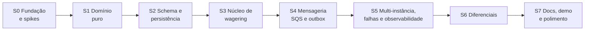

# Backlog — Plano de Sprints

> Plano high-level para seguir como backlog. Os IDs entre colchetes (`[RF-H06]`, `[T-C02]`…) apontam para o [OVERVIEW.md](OVERVIEW.md).
> Marque `[x]` ao concluir um item. Quando uma decisão mudar durante a execução, atualize o [ARCHITECTURE.md](../ARCHITECTURE.md) no mesmo PR.

**Ordem de prioridade:** o que vale pontos e o que é eliminatório vem primeiro (correção financeira, concorrência, idempotência, mensageria). Autenticação vale 0 pontos e fica para o fim, com timebox.

## Definition of Done (vale para todo item)

- `bun run typecheck`, `bun run lint` e as suítes afetadas passando.
- Nenhum `number` para dinheiro; nenhum import de NestJS/MikroORM dentro de `src/domain`.
- Garantias de banco cobertas por teste de integração (não só por teste de unidade).
- Testes de concorrência terminam com `assertLedgerConsistency`.
- Logs sem payload financeiro completo.
- Documentação atualizada quando a decisão/contrato mudar.

---

## Sprint 0 — Fundação e spikes

**Objetivo:** esqueleto rodando com Bun + NestJS + MikroORM + PostgreSQL + LocalStack, e riscos técnicos de stack eliminados.

- [x] **S0-01** `git init`, `.gitignore`, `.editorconfig`, versão do Bun fixada, `package.json` com scripts-base
- [x] **S0-02** `tsconfig` estrito (`strict`, `noUncheckedIndexedAccess`, `exactOptionalPropertyTypes`, `experimentalDecorators`, `emitDecoratorMetadata`) e Biome (lint + format) com regra contra `parseFloat`/`Number(` em código monetário
- [x] **S0-03** NestJS bootstrapado sob Bun (`bun src/main.ts`), `enableShutdownHooks`
- [x] **S0-04** `docker-compose.yml`: PostgreSQL 17, LocalStack (SQS) com script de init criando `wager-transactions.fifo`, `wager-transactions-dlq.fifo` (redrive `maxReceiveCount`) e `wagering-events.fifo`
- [x] **S0-05** **Spike MikroORM + Bun**: `EntitySchema` (sem decorators no domínio), `em.transactional`, `LockMode.PESSIMISTIC_WRITE`, CLI de migrations (`up`/`down`) rodando sob Bun. Registrar resultado no ARCHITECTURE (ADR-001)
- [x] **S0-06** Config tipada e validada com `zod` (falha rápida no boot)
- [x] **S0-07** Logger JSON (pino) baseline + `GET /health/live`
- [x] **S0-08** Harness de testes: `bun test` separado por suíte (`test:unit`, `test:integration`, `test:concurrency`), banco isolado por arquivo de teste (`CREATE DATABASE … TEMPLATE`), helpers `waitFor` (sem `sleep` fixo)
- [ ] **S0-09** CI no GitHub Actions (Linux) subindo o Compose e rodando as suítes [D-08]

**Critério de saída:** `docker compose up` + `bun run dev` sobem a app; `bun run test` roda (mesmo vazio) contra containers reais; migration de exemplo faz `up` e `down`.

---

## Sprint 1 — Domínio puro

**Objetivo:** todas as invariantes encapsuladas em classes TypeScript puras, 100% testadas em unidade.

- [ ] **S1-01** `Money` sobre `bigint` (centavos): `from`, `zero`, `add`, `subtract`, `negate`, comparações, `toJSON`, `toString`, `assertSameCurrency` [RF-D01, RF-D02, T-U01, T-U04]
- [ ] **S1-02** Erros de domínio tipados (`DomainError`, `CurrencyMismatchError`, `InvalidMoneyError`, `InvalidTransactionStateError`, …)
- [ ] **S1-03** `FailureCode` (enum + metadados: categoria, retryable, ação sugerida ao provedor) [RF-D08]
- [ ] **S1-04** `Wallet`: `open`, `rehydrate`, `debit`/`credit` retornando o `WalletLedgerEntry` gerado; `version` [RF-D03, T-U02]
- [ ] **S1-05** `WalletLedgerEntry` imutável com validação aritmética na factory [RF-D05, T-U07]
- [ ] **S1-06** `WagerTransaction`: `create`, `rehydrate`, transições, `isTerminal`, `affectsBalance`, `requiresReference`, `matchesPayload`, `ledgerDirectionFor`, `scheduleReferenceRetry` [RF-D04, T-U06]
- [ ] **S1-07** Serviço de domínio `WagerPolicy` (ou equivalente): aplica BET/WIN/LOSS/REFUND/ROLLBACK sobre wallet + referência e decide `PROCESSED`/`REJECTED`/`PENDING_REFERENCE` [RN-01..RN-12, T-U03]
- [ ] **S1-08** `InboxMessage`, `OutboxMessage` (backoff exponencial com jitter e teto) [RF-D06, T-U08]
- [ ] **S1-09** `IntegrationEvent<T>` abstrato + `WagerTransactionProcessed`, `WagerTransactionRejected`, `WalletBalanceChanged`, `WagerTransactionPendingReference`, `WalletOpened` [RF-D07]
- [ ] **S1-10** `PayloadHasher`: JSON canônico (chaves ordenadas, `amount` normalizado) + SHA-256 [RN-14, T-U05]

**Critério de saída:** `bun run test:unit` verde; `src/domain` não importa nada fora de si mesmo.

---

## Sprint 2 — Schema e persistência

**Objetivo:** o banco é a última linha de defesa — todas as garantias da seção 6 do desafio aplicadas no schema.

- [x] **S2-01** Roles `wallet_owner` (migrations) e `wallet_app` (runtime, grants mínimos) via init do Postgres [D-09] — antecipado no Sprint 0 (init do Compose + migration `bootstrap`)
- [ ] **S2-02** Migration `wallets` (`UNIQUE (player_id, currency)`, `CHECK balance >= 0`, `CHECK version >= 1`, formato da moeda)
- [ ] **S2-03** Migration `wager_transactions` (unicidades de idempotência e external id, CHECKs por kind/status, índice parcial "uma reversão por referência", índices do worker, FK de referência)
- [ ] **S2-04** Migration `wallet_ledger_entries` (UNIQUE por transação, `UNIQUE (wallet_id, wallet_version)`, CHECK aritmético, trigger de imutabilidade, trigger de encadeamento, `REVOKE UPDATE, DELETE, TRUNCATE`)
- [ ] **S2-05** Constraint trigger **diferido** `wallet.balance == último balance_after` validado no COMMIT [D-02]
- [ ] **S2-06** Trigger que impede transição a partir de estado terminal em `wager_transactions`
- [ ] **S2-07** Migrations `inbox_messages` e `outbox_messages`
- [ ] **S2-08** `EntitySchema`s + mappers persistência ↔ domínio (`rehydrate`), mapeamento de `Money` (`numeric` ⇄ string ⇄ bigint)
- [ ] **S2-09** Portas e repositórios (`WalletRepository.lockForUpdate`, `WagerTransactionRepository`, `LedgerRepository`, `OutboxRepository`, `InboxRepository`) e `UnitOfWork` sobre `em.transactional`
- [ ] **S2-10** Use case `CreateWallet` + `POST /wallets` (OPENING + CREDIT + `WalletOpened`/`WalletBalanceChanged` na outbox) [RF-H01]
- [ ] **S2-11** `GET /wallets/:id` e `GET /wallets/:id/ledger` com cursor keyset opaco [RF-H02, RF-H03]
- [ ] **S2-12** Testes de integração de constraints: tentar violar cada garantia direto via SQL e ver o banco recusar; `up → down → up` [T-I01]

**Critério de saída:** nenhuma garantia de unicidade/imutabilidade/não-negatividade depende só de código de aplicação.

---

## Sprint 3 — Núcleo de wagering (HTTP)

**Objetivo:** `POST /wagering/transactions` correto sob concorrência e idempotente.

- [ ] **S3-01** Use case `ProcessWagerTransaction`: lock da wallet → checagem de idempotência → resolução de referência → política de domínio → persistência (tx, wallet, ledger, outbox) numa transação [RF-Q01]
- [ ] **S3-02** Retry limitado para erros transitórios de banco (`40P01`, `55P03`, `40001`, conexão) e para corrida de `23505` em idempotência
- [ ] **S3-03** Snapshot do resultado (`result_balance_amount`) para replay fiel [RN-10]
- [ ] **S3-04** Controller + DTOs (zod) + `Idempotency-Key` obrigatório + rejeição de `OPENING` [RF-H06, RN-13]
- [ ] **S3-05** Filtro de exceções com `application/problem+json`, `code`, `retryable` e o mapeamento HTTP do ARCHITECTURE [RF-H09]
- [ ] **S3-06** Consultas `GET /wagering/transactions/:id` e `GET /providers/:providerId/wagering/transactions/:externalId` [RF-H04, RF-H05]
- [ ] **S3-07** Reconciliação `POST /wallets/:id/reconciliation` (snapshot `REPEATABLE READ`, log + métrica em divergência) [RF-H07]
- [ ] **S3-08** Testes de integração de todas as regras de negócio contra o banco real (inclui reversões, overdraw de reversão, referência de outro round/player)
- [ ] **S3-09** Concorrência: T-C01 (50x a mesma aposta), T-C02 (100 vs 80+80), T-C03 (wallets distintas) via HTTP real e via use case direto com pools independentes

**Critério de saída:** cenário obrigatório da seção 8 do desafio passa de forma determinística em 100 execuções seguidas.

---

## Sprint 4 — Mensageria: SQS, inbox, outbox, pending references

**Objetivo:** entrada assíncrona e publicação de eventos à prova de crash.

- [ ] **S4-01** Adapter SQS (client, long polling, `AbortController` para shutdown)
- [ ] **S4-02** Consumer `wager-transactions.fifo` → mesmo use case com contexto de inbox `(consumerName, messageId)` na mesma transação [RF-Q01, RF-Q02]
- [ ] **S4-03** `DeleteMessage` só após commit; classificação negócio/transitório/permanente; backoff via `ChangeMessageVisibility`; DLQ por redrive e envio explícito para erros permanentes [RF-Q03..RF-Q05]
- [ ] **S4-04** Shutdown gracioso do consumer: para de receber, conclui em andamento, devolve visibilidade (`ChangeMessageVisibility 0`) do que não começou [RF-Q06]
- [ ] **S4-05** Outbox publisher: `FOR UPDATE SKIP LOCKED`, `SendMessageBatch`, `MessageDeduplicationId = eventId`, `scheduleRetry` em falha [RF-Q07]
- [ ] **S4-06** Worker `PENDING_REFERENCE`: varredura com backoff, TTL/limite, "nudge" quando a referência chega, `REJECTED REFERENCE_NOT_FOUND` + evento ao esgotar [RF-Q09, RN-11]
- [ ] **S4-07** `FaultInjector` (porta no-op em produção) com pontos `before-commit`, `after-commit-before-ack`, `after-commit-before-publish-mark`
- [ ] **S4-08** Testes: inbox/redelivery [T-I03], dois publishers [T-I04, T-C06], retry/DLQ [T-I05], atomicidade com falha injetada [T-I02], referência fora de ordem [T-C07], crash após commit e antes do ack [T-C05]

**Critério de saída:** matar o processo em qualquer ponto de injeção nunca duplica efeito nem perde evento.

---

## Sprint 5 — Multi-instância, resiliência e observabilidade

**Objetivo:** provar correção com ≥ 3 instâncias e dar diagnóstico operacional.

- [ ] **S5-01** Papéis por processo (`APP_ROLES=api,consumer,outbox-publisher,pending-reference-worker`) e Compose com 3 réplicas atrás de um load balancer (nginx)
- [ ] **S5-02** Contexto de correlação (`AsyncLocalStorage`) propagado HTTP → use case → outbox → SQS; logs com `correlationId`, `messageId`, `transactionId`, `walletId`, `providerId`; `redact` de valores [RNF-04]
- [ ] **S5-03** Métricas Prometheus em `GET /metrics` (lista no ARCHITECTURE §10) [RNF-05, RF-H10]
- [ ] **S5-04** `GET /health/ready` (PostgreSQL + SQS, e 503 durante shutdown) [RF-H08]
- [ ] **S5-05** Resiliência: PostgreSQL fora → HTTP 503 + `Retry-After`, consumer não dá ack; SQS fora → outbox acumula e drena depois [RNF-03]
- [ ] **S5-06** Teste com ≥ 3 processos (`Bun.spawn` ou réplicas do Compose) disputando as mesmas wallets por HTTP e SQS [T-C04]
- [ ] **S5-07** Teste de reinício: `docker compose restart`/`kill -9` no meio da carga → consistência final comprovada [T-C08, T-I06]
- [ ] **S5-08** Shutdown gracioso testado com `SIGTERM` real em container Linux [RNF-07]

**Critério de saída:** todas as suítes obrigatórias (seção 13 do desafio) verdes.

---

## Sprint 6 — Diferenciais

**Objetivo:** ir além, sem comprometer o que já está correto. Cada item tem timebox.

- [ ] **S6-01** Teste de carga `bun run test:load` (cenários: wallets uniformes, hot wallet, ingestão SQS) + `docs/LOAD_TEST.md` com ambiente, metodologia, throughput, p50/p95/p99, taxa de erro, conflitos e outbox lag [D-01]
- [ ] **S6-02** Prometheus + Grafana provisionados (profile `observability`) com dashboard [D-03]
- [ ] **S6-03** Keycloak no Compose com realm importado; `JwtAuthGuard` (JWKS via `jose`), `ProviderIdentityPort`, `providerId` do token × body, role de backoffice para wallets/reconciliação; `AUTH_MODE=disabled` para testes [D-04]
- [ ] **S6-04** Job periódico de reconciliação por amostragem [D-07]
- [ ] **S6-05** OpenTelemetry (traces) — somente se a instrumentação funcionar bem sob Bun [D-05]
- [ ] **S6-06** *(stretch)* Ledger de partidas dobradas com conta da casa por provedor [D-06]

---

## Sprint 7 — Documentação, demo e polimento

- [ ] **S7-01** `README.md`: pré-requisitos, setup, comandos, como rodar cada suíte, troubleshooting (Windows/WSL2)
- [ ] **S7-02** `ARCHITECTURE.md` final: ADRs atualizados, trade-offs, limitações conhecidas, resultados do teste de carga
- [ ] **S7-03** Script de demo para a apresentação (cenário 100 vs 80+80, 50x paralelo, crash antes do ack, referência fora de ordem) [D-10]
- [ ] **S7-04** Revisão final contra o checklist de falhas eliminatórias do OVERVIEW
- [ ] **S7-05** Limpeza: código morto, TODOs, consistência de nomes

---

## Riscos e mitigação

| Risco | Impacto | Mitigação |
|---|---|---|
| MikroORM (CLI/migrations/metadata) com atrito sob Bun | Alto | Spike no S0-05; usar `EntitySchema` com tipos explícitos (sem depender de `reflect-metadata`/`ts-morph`); fallback: rodar CLI de migration com Node só para o comando, documentado |
| Instrumentação OTel não compatível com Bun | Baixo | É opcional; manual spans ou pular |
| Sinais POSIX (`SIGTERM`, `SIGKILL`) no Windows | Médio | Testes de crash/shutdown rodam em containers Linux / WSL2 / CI |
| Diferenças do LocalStack vs SQS real (FIFO, redrive) | Médio | Testar redrive explicitamente; documentar comportamento observado |
| Testes de concorrência flaky | Alto | Barreiras explícitas, `waitFor` com timeout, sem `sleep`; rodar 100x no CI antes de considerar pronto |
| Timebox estourar em diferenciais | Médio | Diferenciais só depois do S5 verde; auth com timebox rígido |
